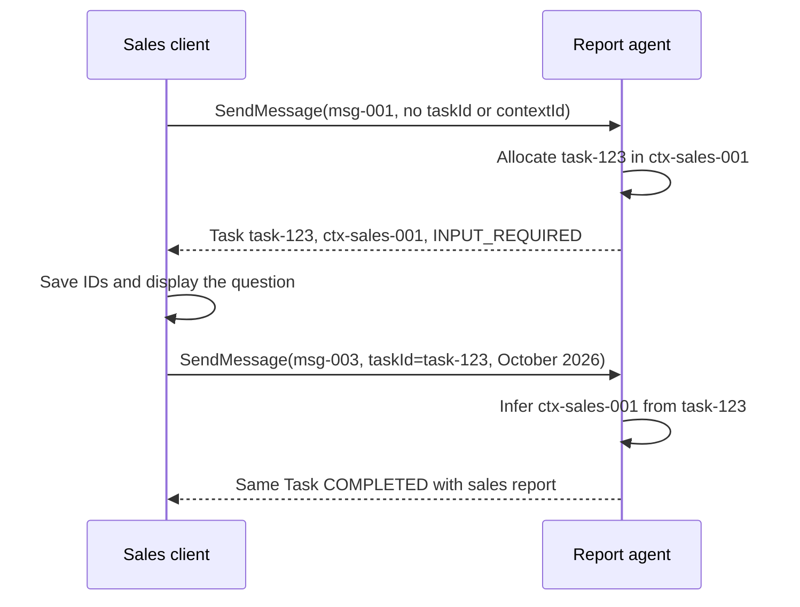

# A2A Core Concepts: The Protocol Vocabulary

> **Who this is for**: Engineers new to A2A who need the shared glossary. Every later file in this repo assumes you know the terms defined here. Before reading this, understand the high-level picture: **[What Is A2A?](01_what_is_a2a.md)**.

A2A (Agent2Agent) is a protocol for one autonomous agent to discover, call, and collaborate with another over HTTP. To do that, both sides must agree on a small set of nouns: who the participants are, how they advertise themselves, and the shape of the data that flows between them.

This file targets wire protocol **1.0** and was checked against specification release **1.0.1**. Treat it as the dictionary you keep open while reading everything else.

---

## 1️⃣ The Two Roles: A2A Server and A2A Client

A2A is a client–server protocol. Every interaction has exactly two participants, and the roles describe *behavior in a single exchange* — not a fixed identity.

- **A2A Server** — also called the **remote agent**. It is the agent being called. It hosts an HTTP endpoint, publishes an **Agent Card**, receives requests, runs work, and returns Tasks, Messages, and Artifacts.
- **A2A Client** — the calling agent or application. It discovers a server via its Agent Card, then sends requests to that server's endpoint and consumes the responses.

The roles are per-conversation, not permanent. An agent that is a server to a user-facing app can simultaneously be a client of specialist agents it delegates to.

```
   User-facing app                  Specialist agent
   ┌──────────────┐                 ┌──────────────┐
   │  A2A Client  │ ──── request ──▶│  A2A Server  │
   │              │ ◀─── Task ───── │ (remote agent)│
   └──────────────┘                 └──────┬───────┘
                                            │ same agent,
                                            │ now acting as
                                            ▼
                                     ┌──────────────┐
                                     │  A2A Client  │ ──▶ another server
                                     └──────────────┘
```

The protocol itself is transport-bound to HTTP and uses JSON-RPC 2.0 (or gRPC / HTTP+JSON, depending on the interface the server advertises). What matters for the vocabulary is the *data shapes* below — they are the same regardless of transport.

---

## 2️⃣ Agent Card: The Discovery Document

The **Agent Card** is a JSON document that a server publishes so clients can find it and know how to talk to it. It is the entry point for everything: a client reads the card *before* sending any request.

It declares, at minimum:

- **Identity** — `name`, `description`, and the agent's own `version`.
- **Supported interfaces** — where to send requests (`supportedInterfaces`), ordered by server preference.
- **Capabilities** — feature flags such as streaming and push notifications (`capabilities`).
- **Security schemes** — how a client authenticates (`securitySchemes`) and which schemes are required (`securityRequirements`).
- **Skills** — a list of `AgentSkill` objects describing what the agent can do.

```json
{
  "name": "Weather Agent",
  "description": "Provides forecasts and severe-weather alerts.",
  "version": "2.1.0",
  "supportedInterfaces": [
    {
      "url": "https://weather.example.com/a2a",
      "protocolBinding": "JSONRPC",
      "protocolVersion": "1.0"
    }
  ],
  "capabilities": { "streaming": true, "pushNotifications": false },
  "defaultInputModes": ["text/plain"],
  "defaultOutputModes": ["text/plain", "application/json"],
  "securitySchemes": {
    "bearer": {
      "httpAuthSecurityScheme": { "scheme": "Bearer", "bearerFormat": "JWT" }
    }
  },
  "securityRequirements": [
    { "schemes": { "bearer": { "list": [] } } }
  ],
  "skills": []
}
```

An Agent Card is analogous to an OpenAPI document only as machine-readable discovery. The analogy stops at granularity: a card advertises coarse skills, interfaces, and security requirements; it does not define every operation's request and response schema. Clients should read the card instead of hardcoding endpoints or capabilities.

This is only a sketch. The full card structure — signatures, extended cards, transport negotiation — is covered in **[The Agent Card](../02_protocol/01_agent_card.md)**.

---

## 3️⃣ AgentSkill: A Unit of Advertised Capability

An **AgentSkill** is one discrete capability the agent advertises inside its Agent Card's `skills` array. Skills let a client (or an orchestrating agent) decide *which* agent to route a request to.

| Field         | Type       | Meaning |
|---------------|------------|---------|
| `id`          | string     | Stable, unique identifier for the skill. |
| `name`        | string     | Short human-readable name. |
| `description` | string     | What the skill does, in prose. |
| `tags`        | string[]   | Keywords for categorization and discovery. |
| `examples`    | string[]   | Sample prompts or use cases the skill handles. |
| `inputModes`  | string[]   | MIME types the skill accepts (overrides the card's `defaultInputModes`). |
| `outputModes` | string[]   | MIME types the skill produces (overrides `defaultOutputModes`). |

```json
{
  "id": "forecast-lookup",
  "name": "Weather Forecast",
  "description": "Returns a multi-day forecast for a named location.",
  "tags": ["weather", "forecast", "geo"],
  "examples": [
    "What's the weather in Lisbon this weekend?",
    "5-day forecast for 48.85, 2.35"
  ],
  "inputModes": ["text/plain"],
  "outputModes": ["application/json"]
}
```

`inputModes` and `outputModes` are media types, not free-form labels. They tell the client what it may send and what the skill can return.

---

## 4️⃣ Task: The Stateful Unit of Work

A **Task** is the central object of A2A. When a client asks a server to *do something*, the server may create a Task to represent that work. A Task is **stateful** and **server-owned**: the server assigns its `id` and is the sole authority on its status.

| Field       | Type        | Meaning |
|-------------|-------------|---------|
| `id`        | string      | Server-generated unique identifier for this Task. |
| `contextId` | string      | Groups this Task with related Tasks/Messages (see §8). |
| `status`    | TaskStatus  | Current lifecycle state — `{ state, message?, timestamp? }`. |
| `history`   | Message[]   | Ordered conversational turns exchanged for this Task. |
| `artifacts` | Artifact[]  | Tangible outputs the Task has produced. |
| `metadata`  | object      | Arbitrary key-value data attached by the server. |

```json
{
  "id": "task-9f3c1e",
  "contextId": "ctx-trip-planning-42",
  "status": {
    "state": "TASK_STATE_WORKING",
    "timestamp": "2026-05-18T14:03:11Z"
  },
  "history": [],
  "artifacts": [],
  "metadata": { "priority": "normal" }
}
```

The `status.state` field uses **ProtoJSON**, Protocol Buffers' canonical mapping to JSON. That mapping is why the wire carries strings such as `TASK_STATE_SUBMITTED`, `TASK_STATE_WORKING`, `TASK_STATE_INPUT_REQUIRED`, `TASK_STATE_COMPLETED`, `TASK_STATE_FAILED`, and `TASK_STATE_CANCELED` rather than Python enum names or arbitrary lowercase labels. Not every interaction needs a Task — a quick question may be answered with a single Message and no Task at all. The full state machine is covered in **[Task Lifecycle](../02_protocol/03_task_lifecycle.md)**.

A Task is long-lived and server-owned. Its stable `id` lets a client reconnect and observe the same work later.

---

## 5️⃣ Message: One Conversational Turn

A **Message** represents a single turn in the conversation between client and server — a request, a reply, a clarification. Messages are *ephemeral communication*, in contrast to a Task (durable state) and an Artifact (durable output).

| Field               | Type       | Meaning |
|---------------------|------------|---------|
| `messageId`         | string     | Unique identifier created by the sender. |
| `role`              | enum       | `ROLE_USER` (from the client) or `ROLE_AGENT` (from the server). |
| `parts`             | Part[]     | The content of the turn — one or more Parts. |
| `contextId`         | string     | Optional on client Messages; required on server Messages (see §8). |
| `taskId`            | string     | Task this Message relates to, if any. |
| `referenceTaskIds`  | string[]   | Other Tasks this Message refers to. |
| `metadata`          | object     | Arbitrary sender-supplied data. |
| `extensions`        | string[]   | URIs of protocol extensions in use. |

```json
{
  "messageId": "msg-001",
  "role": "ROLE_USER",
  "contextId": "ctx-trip-planning-42",
  "parts": [
    { "text": "Plan a 3-day trip to Kyoto in autumn." }
  ]
}
```

`role` is relative to the protocol, not to a human. `ROLE_USER` means the calling side of this A2A exchange even when that caller is another autonomous agent.

---

## 6️⃣ Part: The Unit of Content

A **Part** is the smallest piece of content. Every Message and every Artifact carries a list of Parts. There are **three logical kinds** of content a Part can hold:

- **Text content** — plain text. Carries a `text` field.
- **File content** — a file, supplied either *inline* as base64 bytes (`raw`) **or** *by reference* as a URL (`url`). Carries `mediaType` and optional `filename`.
- **Data content** — structured machine-readable JSON. Carries a `data` field (any JSON value) — used for forms, parameters, and tool-style payloads.

⚠️ **v1.0 change**: In v1.0 these are *not* three separate object types. The spec defines a **single unified `Part`** object, and the kind is determined by **which field is present** — there is no `kind` discriminator field (that field existed in pre-1.0 drafts and was removed). Likewise `mimeType` was renamed to `mediaType`.

Text Part:

```json
{ "text": "Kyoto is best visited in November for autumn foliage." }
```

File Part by reference:

```json
{
  "url": "https://cdn.example.com/itinerary.pdf",
  "mediaType": "application/pdf",
  "filename": "itinerary.pdf"
}
```

File Part inline, with base64-encoded bytes in `raw`:

```json
{
  "raw": "JVBERi0xLjcKJ...",
  "mediaType": "application/pdf",
  "filename": "itinerary.pdf"
}
```

Data Part:

```json
{
  "data": {
    "destination": "Kyoto",
    "nights": 3,
    "season": "autumn"
  }
}
```

To dispatch on a Part's kind, check field presence rather than a type tag:

```
if ("text" in part)        -> text content
else if ("data" in part)   -> structured JSON
else if ("raw" in part)    -> inline file bytes (base64)
else if ("url" in part)    -> file by reference
```

A single Message can mix Part kinds, such as text instructions, structured `data`, and a file attachment.

---

## 7️⃣ Artifact: A Tangible Task Output

An **Artifact** is a concrete result produced by a Task — a generated report, an image, a structured dataset. Like a Message, an Artifact is **composed of Parts**, but its purpose is different: a Message is a turn of *conversation*, an Artifact is a *deliverable* that persists on the Task.

| Field        | Type     | Meaning |
|--------------|----------|---------|
| `artifactId` | string   | Identifier, unique within the owning Task. |
| `name`       | string   | Optional human-readable label. |
| `description`| string   | Optional explanation of the Artifact. |
| `parts`      | Part[]   | The content — at least one Part. |
| `metadata`   | object   | Optional arbitrary data. |
| `extensions` | string[] | Optional extension URIs. |

```json
{
  "artifactId": "art-itinerary-1",
  "name": "Kyoto 3-Day Itinerary",
  "description": "Day-by-day plan with map links.",
  "parts": [
    { "text": "Day 1: Fushimi Inari at sunrise..." },
    { "data": { "days": 3, "totalCostEstimateUSD": 640 } }
  ]
}
```

Messages are how agents talk; Artifacts are what they produce. A Task's `history` holds the conversation, while `artifacts` holds results. A completed Task can have zero, one, or several Artifacts; completion is a lifecycle fact, not a promise that `artifacts[0]` exists.

`artifactId` identifies an output within its Task. `name` is an optional display label, not a required or unique lookup key. Two outputs can share a name, and one output can contain several Parts. A frontend should preserve all outputs by `(task.id, artifactId)` and all their Parts. If it needs a specific report/chart layout, agree an application schema for output meaning, media types and missing outputs. A2A itself does not assign those business meanings.

---

## 8️⃣ Identity: From the First Request to the Next Turn

Suppose the client asks for a sales report. Before receiving any reply it knows its outgoing Message, but it does not yet know whether the server will create a Task. Inventing a `taskId` would claim that a Task already exists. Instead, the first request normally omits both `taskId` and `contextId`; the response supplies the identity the client needs for later turns.

### Who creates each ID?

| Identifier | Creator | What the client does with it |
|---|---|---|
| JSON-RPC envelope `id`, such as `req-001` | Calling side; the Python SDK's JSON-RPC transport generates it | Match one RPC response to its request. It is not a Task or conversation ID. |
| Message `messageId`, such as `msg-001` | That Message's sender | Create a fresh ID for a new turn; retain the same ID for a retry only under the server's deduplication contract. |
| Task `id`, such as `task-123` | Server when it creates work | Save it; send it as Message `taskId` to address that existing Task or as `GetTask.params.id` to read it. |
| `contextId`, such as `ctx-sales-001` | Server can allocate it when omitted; client-created values depend on server acceptance | Save the returned value and reuse it for conversation continuity. Treat server-generated values as opaque. |
| `artifactId`, such as `art-summary` | Output-producing server; a server SDK helper may allocate it | Track the output within its owning Task. |

If a client supplies a new `contextId`, a server that accepts it preserves it; a server that cannot accept it rejects the request instead of silently substituting another context. The portable starting point is to omit it until you know the server's policy. Supplying a new `taskId` never creates a Task: an unknown ID produces `TaskNotFoundError`.

These are [protocol identity rules](https://a2a-protocol.org/latest/specification/#34-multi-turn-interactions); allocation by a particular SDK helper is an implementation detail. In the [Python server baseline](../03_python/02_building_a_server.md), server-side helpers and the handler provide identity while the executor decides which work/output to produce. The client does not allocate remote Task IDs.

### Watch identity cross the first request boundary

This Task-producing server needs the reporting month before it can finish. The new Message ID changes on the answer, but the selected Task remains the same.



The last request can omit `contextId` because `taskId` resolves it. Supplying both is also valid, provided they match. A context-only Message does not select the waiting Task: it starts another interaction within that conversation, and the agent decides whether to answer with a Message or create work. [Task Lifecycle](../02_protocol/03_task_lifecycle.md) develops the full input-required exchange.

A direct Message reply is another valid first-response path. It has a server-created `messageId` and a `contextId`, without a `taskId`. Save its context too: a conversation can continue even when no Task was created.

### A conversation context is not every kind of session

A **contextId** groups related Tasks and Messages. It does not itself guarantee retained LLM memory, a durable event log, or unlimited history. The server decides what context it retains and when it expires. [The specification](https://a2a-protocol.org/latest/specification/#341-context-identifier-semantics) makes those persistence policies server-specific.

| Name you may encounter | Meaning and owner |
|---|---|
| Application/login session ID | Your application or authentication system identifies a browser/user session. It can contain multiple agent conversations. |
| A2A `contextId` | Conversation grouping at the selected remote agent. Keep it associated with that agent endpoint and caller. |
| SDK credential-store `sessionId` | Caller-provided lookup key in `ClientCallContext.state`; it selects credentials, not conversational work. |
| Framework session / LangGraph `thread_id` | Framework persistence key. The server adapter must deliberately map the A2A context to it; A2A does not create this mapping automatically. |

For example, your backend may store application session `app-42` -> report-agent context `ctx-sales-001` -> Tasks `task-123` and `task-456`. It separately looks up credentials under `credentials-42`. Matching these strings is an application choice, not a protocol requirement; none of them grants authorization by itself. See the [client credential example](../03_python/03_building_a_client.md#7-passing-auth-credentials).

---

## 9️⃣ How It All Nests

Two container hierarchies sit under a Task. Both bottom out at **Part** — the universal content unit.

```
contextId  "ctx-trip-planning-42"   ── the conversation
   │
   └── Task                          ── stateful unit of work (server-owned id)
        │
        ├── status        TaskStatus { state, message?, timestamp? }
        │
        ├── history ──▶ Message      ── one conversational turn (ROLE_USER/ROLE_AGENT)
        │                  │
        │                  └── parts ──▶ Part   ── text | raw/url file | data
        │
        └── artifacts ──▶ Artifact   ── a tangible deliverable
                             │
                             └── parts ──▶ Part ── text | raw/url file | data
```

Read it as two sentences:

- **Task → Message → Part** — the *conversation* path: what was said, turn by turn.
- **Task → Artifact → Part** — the *output* path: what was produced.

Every content payload a client sends or a server returns is ultimately represented by Parts inside a Message or an Artifact.

---

## 🔟 Summary Table

| Concept        | What it is | Key fields | Lifetime |
|----------------|-----------|------------|----------|
| **A2A Server** | The remote agent being called; hosts the endpoint and Agent Card. | — (a role) | — |
| **A2A Client** | The calling agent/app; discovers and invokes a server. | — (a role) | — |
| **Agent Card** | JSON discovery document describing a server. | `name`, `supportedInterfaces`, `capabilities`, `securitySchemes`, `securityRequirements`, `skills` | Published, stable |
| **AgentSkill** | One advertised capability inside the card. | `id`, `name`, `description`, `tags`, `examples`, `inputModes`, `outputModes` | Stable |
| **Task**       | Stateful, server-owned unit of work. | `id`, `contextId`, `status`, `history`, `artifacts`, `metadata` | Long-lived, resumable |
| **Message**    | One conversational turn. | `messageId`, `role`, `parts`, `contextId`, `taskId` | Ephemeral |
| **Part**       | Smallest content unit; kind by field presence. | `text` / `raw`+`url` / `data`, `mediaType`, `filename` | Inside a Message/Artifact |
| **Artifact**   | A tangible Task output. | `artifactId`, `name`, `description`, `parts`, `metadata` | Durable on the Task |
| **contextId**  | Identifier grouping Tasks/Messages into one conversation. | (a string, e.g. UUID) | Spans the whole session |

> **Key insight**: Three nouns carry all the data — **Message** (talk), **Artifact** (output), **Part** (content). Two nouns carry identity and scope — **Task** (`id`) and **contextId** (conversation). Everything else in A2A is built on these.

---

**Next**: [Part 3: A2A vs MCP](03_a2a_vs_mcp.md)

## Recap and check yourself

- The client sends a Message; the server can create a Task to own work that continues after the reply.
- A Part carries content inside a Message or Artifact. An Artifact is produced output attached to a Task.
- A Task `id` selects one job; `contextId` groups related jobs and messages. Save context from direct Message replies too. Application and credential sessions have separate owners.
- On the wire, Task states use ProtoJSON enum names such as `TASK_STATE_WORKING`.

**Q: The server starts a second hotel-booking Task in `ctx-trip-planning-42`. Which ID polls only the hotel booking?**

<details><summary>Answer</summary>

Use the new Task's `id`. `contextId` groups it with the earlier trip-planning work but does not select an individual Task.

</details>

**Q: The Kyoto agent returns a generated itinerary PDF. Does the PDF belong in the client's request Message or in the server's Task Artifact?**

<details><summary>Answer</summary>

It is server-produced output, so it belongs in an Artifact Part on the Task. The request Message records what the client asked for.

</details>

**Q: You know `task-123` but omit `contextId` when answering its question. Does the server create a second Task?**

<details><summary>Answer</summary>

No. The existing `taskId` selects the Task, and the server infers its context. If you supply a different context alongside that Task ID, the server rejects the mismatch. Sending only the original context would preserve conversation grouping without selecting the waiting Task.

</details>
