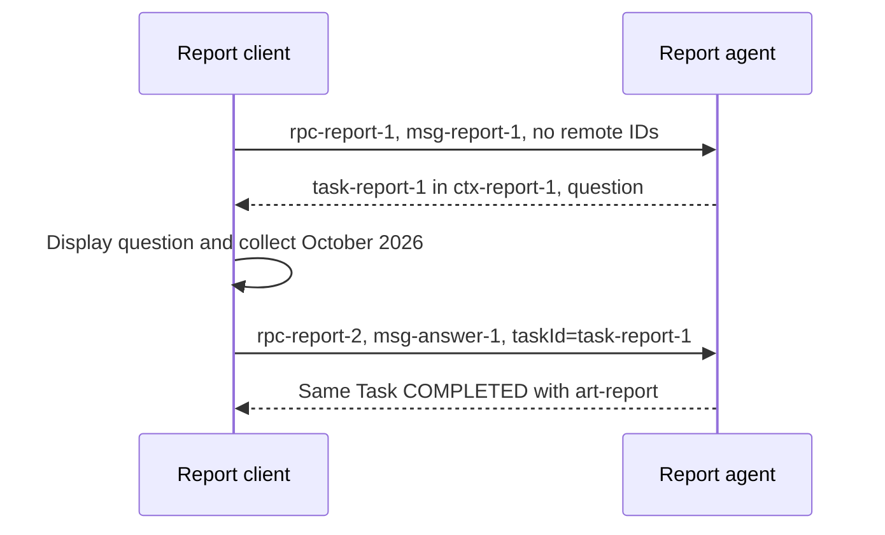

# Follow the Messages: Client Requests, Agent Replies, and Live Streaming

> **Start here if the protocol vocabulary feels disconnected.** You need basic HTTP and JSON, not prior streaming knowledge. We follow one report request from the client's first Message to the displayed result. The wire format is A2A **1.0**; the runnable lab uses Python SDK **1.1.2**.

A client sends **a Message describing what it wants**. The server decides whether to answer with a Message or create a Task. Streaming changes how the client receives the answer over time; it does not mean the client sends the Task's internal state back to the server.

| Client wants to… | What it sends |
|---|---|
| Ask a new question | A new Message, normally without Task/context IDs |
| Answer an agent's question on a paused Task | A new Message containing the answer and that existing `taskId` |
| Ask for another report in the same conversation | A new Message with the existing `contextId`, without the completed Task's `taskId` |
| Receive an answer as updates arrive | The Message through `SendStreamingMessage` |
| Watch work that already has an ID | `SubscribeToTask` or `GetTask`, not another copy of the original Message |

The examples below use readable IDs such as `task-report-1`. The lab generates actual IDs; copy the returned values rather than these illustrative strings. Each exchange is an alternative run unless explicitly described as a continuation.

## 1. Start with one ordinary request and reply

The client wants to ask `What is 2 + 2?`. It creates this **Message**:

```json
{
  "messageId": "msg-math-1",
  "role": "ROLE_USER",
  "parts": [{"text": "What is 2 + 2?"}]
}
```

`parts` contains the content; `messageId` identifies this turn. `ROLE_USER` means the calling side, even when the caller is another agent. There is no Task ID because the client has not received a Task.

To send it over JSON-RPC, the client puts that Message inside an RPC request. This is the **complete HTTP body** posted to the agent's advertised JSON-RPC endpoint:

```json
{
  "jsonrpc": "2.0",
  "id": "rpc-math-1",
  "method": "SendMessage",
  "params": {
    "message": {
      "messageId": "msg-math-1",
      "role": "ROLE_USER",
      "parts": [{"text": "What is 2 + 2?"}]
    }
  }
}
```

The server in this example handles this calculation directly:

```json
{
  "jsonrpc": "2.0",
  "id": "rpc-math-1",
  "result": {
    "message": {
      "messageId": "msg-math-2",
      "contextId": "ctx-math-1",
      "role": "ROLE_AGENT",
      "parts": [{"text": "2 + 2 = 4"}]
    }
  }
}
```

The client displays `result.message.parts[0].text` for this particular one-text-Part reply and saves `ctx-math-1` if it wants another turn. There is no Task to poll. Notice that `rpc-math-1` is echoed, while the server creates a different Message ID. RPC identity and Message identity solve different problems.

A Python SDK caller builds `SendMessageRequest(message=Message(...))`; it does not manually add `jsonrpc` or an envelope `id`. The SDK's transport builds that envelope and removes it when parsing the response. The wire uses `messageId`; the Python object uses `message_id`.

## 2. Follow a report through a question and an answer

Now the client asks for a report without specifying a month. The lab's report agent uses a Task because it needs another turn. A different agent could choose a different workflow; the following is the behavior of this example agent.

**First request — client to server:**

```json
{
  "jsonrpc": "2.0",
  "id": "rpc-report-1",
  "method": "SendMessage",
  "params": {
    "message": {
      "messageId": "msg-report-1",
      "role": "ROLE_USER",
      "parts": [{"text": "Generate a sales report"}]
    }
  }
}
```

**First response — server to client:**

```json
{
  "jsonrpc": "2.0",
  "id": "rpc-report-1",
  "result": {
    "task": {
      "id": "task-report-1",
      "contextId": "ctx-report-1",
      "status": {
        "state": "TASK_STATE_INPUT_REQUIRED",
        "message": {
          "messageId": "msg-question-1",
          "role": "ROLE_AGENT",
          "taskId": "task-report-1",
          "contextId": "ctx-report-1",
          "parts": [{"text": "For which month should I generate the report?"}]
        }
      }
    }
  }
}
```

The server allocated `task-report-1` and `ctx-report-1`. The client saves both and displays the question inside `task.status.message.parts`. `INPUT_REQUIRED` means the work is paused; repeatedly reading the Task cannot supply the missing month.

**Second request — the client answers the question:**

```json
{
  "jsonrpc": "2.0",
  "id": "rpc-report-2",
  "method": "SendMessage",
  "params": {
    "message": {
      "messageId": "msg-answer-1",
      "role": "ROLE_USER",
      "taskId": "task-report-1",
      "parts": [{"text": "October 2026"}]
    }
  }
}
```

This is a new Message and a new RPC, directed to the **existing** Task. The client sends the answer, not a modified copy of the Task object. `contextId` can be omitted because the server resolves it from `taskId`; if supplied, it must match.

**Second response — the same work has completed:**

```json
{
  "jsonrpc": "2.0",
  "id": "rpc-report-2",
  "result": {
    "task": {
      "id": "task-report-1",
      "contextId": "ctx-report-1",
      "status": {"state": "TASK_STATE_COMPLETED"},
      "artifacts": [{
        "artifactId": "art-report",
        "name": "sales-report",
        "parts": [{"text": "October sales: $150,000."}]
      }]
    }
  }
}
```

The client now displays the Artifact's Parts. The question was a conversational Message in the status; the report is a deliverable in `artifacts`. Successful completion does not universally guarantee an Artifact, but this particular agent produces one.

Trace the identities below: only the RPC and Message IDs change on the answer.



A new report after completion is a different interaction. Preserve the conversation and reference the prior result, but do not address the completed Task as the work to resume:

```json
{
  "jsonrpc": "2.0",
  "id": "rpc-report-3",
  "method": "SendMessage",
  "params": {
    "message": {
      "messageId": "msg-november-1",
      "role": "ROLE_USER",
      "contextId": "ctx-report-1",
      "referenceTaskIds": ["task-report-1"],
      "parts": [{"text": "Generate a sales report for November 2026"}]
    }
  }
}
```

Our lab creates a different Task in `ctx-report-1`. The earlier Task stays completed. The general protocol also allows a direct Message reply to new work; `contextId` alone is not a command to allocate a Task. The [identity chapter](../01_fundamentals/02_core_concepts.md#who-creates-each-id) explains the allocation and session policies.

## 3. Change delivery: one request, an open response, several updates

In section 2, ordinary `SendMessage` returned one response after the agent paused or finished. If report generation takes time, you may want to display progress and partial output while it runs.

The client now includes the month up front and changes the operation to `SendStreamingMessage`:

```json
{
  "jsonrpc": "2.0",
  "id": "rpc-stream-1",
  "method": "SendStreamingMessage",
  "params": {
    "message": {
      "messageId": "msg-stream-1",
      "role": "ROLE_USER",
      "parts": [{"text": "Generate a sales report for October 2026"}]
    }
  }
}
```

The server responds with HTTP `200` and `Content-Type: text/event-stream`. It keeps **that response** open and writes updates to its body as work proceeds. It does not wait for the client to issue another HTTP request for each update.

Watch the single open response below. The server emits the work's identity, progress, partial output, and completion at different times.

```mermaid
sequenceDiagram
  participant C as Client display
  participant A as Report agent
  C->>A: One POST, SendStreamingMessage
  A-->>C: HTTP 200, text/event-stream; keep response open
  A-->>C: task: submitted, save Task/context IDs
  A-->>C: statusUpdate: WORKING, Fetched sales
  A-->>C: artifactUpdate: art-report, October sales:
  A-->>C: artifactUpdate: same art-report, $150,000.
  A-->>C: statusUpdate: COMPLETED
  Note over C,A: Response ends; Task remains readable by ID
```

The same mechanism works for research progress, file output or generated text. **SSE** (Server-Sent Events) is the framing of the HTTP response; **A2A events** are the typed objects inside it. Here are five representative frames from this stream, with progress details reduced to keep the layers visible:

```text
data: {"jsonrpc":"2.0","id":"rpc-stream-1","result":{"task":{"id":"task-report-2","contextId":"ctx-report-2","status":{"state":"TASK_STATE_SUBMITTED"}}}}

data: {"jsonrpc":"2.0","id":"rpc-stream-1","result":{"statusUpdate":{"taskId":"task-report-2","contextId":"ctx-report-2","status":{"state":"TASK_STATE_WORKING","message":{"messageId":"msg-progress-1","role":"ROLE_AGENT","taskId":"task-report-2","contextId":"ctx-report-2","parts":[{"text":"Fetched sales"}]}}}}}

data: {"jsonrpc":"2.0","id":"rpc-stream-1","result":{"artifactUpdate":{"taskId":"task-report-2","contextId":"ctx-report-2","artifact":{"artifactId":"art-report","parts":[{"text":"October sales: "}]},"append":false,"lastChunk":false}}}

data: {"jsonrpc":"2.0","id":"rpc-stream-1","result":{"artifactUpdate":{"taskId":"task-report-2","contextId":"ctx-report-2","artifact":{"artifactId":"art-report","parts":[{"text":"$150,000."}]},"append":true,"lastChunk":true}}}

data: {"jsonrpc":"2.0","id":"rpc-stream-1","result":{"statusUpdate":{"taskId":"task-report-2","contextId":"ctx-report-2","status":{"state":"TASK_STATE_COMPLETED"}}}}
```

Each blank line ends an SSE event; the `data:` value is JSON. The JSON-RPC ID is the same throughout this one response. The Task ID remains useful across later RPCs too. Network byte chunks do not have to match SSE events: one TCP read may contain half a frame or several frames, so use an SSE parser or the SDK.

Some servers write `event: message` before `data:`. That is an SSE transport label; it does **not** mean `result.message` is present. Inspect the A2A payload inside `result`.

### What exactly is being streamed?

| A2A payload | What it conveys | What the UI does |
|---|---|---|
| `task` | A snapshot, including identity, status and any existing outputs | Save IDs and reconcile the snapshot |
| `statusUpdate` | The Task state and an optional explanatory Message | Show progress, a question, authorization needs or completion |
| `artifactUpdate` | A deliverable or a chunk of it | Replace or append Parts to the identified Artifact |
| `message` | A direct reply without starting a Task | Display its Parts; that direct-response stream then ends |

The four payload cases are defined by [A2A's StreamResponse](https://github.com/a2aproject/A2A/blob/v1.0.1/specification/a2a.proto). A Task-based stream does not send every progress sentence as a top-level Message: it can carry that sentence in `statusUpdate.status.message`.

For `art-report`, the first chunk starts the output and the second appends to it. Rendering all text Parts in order gives `October sales: $150,000.`. `lastChunk: true` finishes this Artifact; the Task could still produce another Artifact before completing. It does not mean the HTTP response must end at that chunk.

An A2A stream is not automatically an LLM token stream. Your executor chooses what to publish. If it awaits an entire model response and emits one Artifact, the client receives one output chunk. To show tokens or phrases, iterate the model's streaming API and emit successive Artifact updates using the **same Artifact ID**. Buffering several tiny tokens into a short phrase is also valid. Tool starts/finishes can be status updates; A2A does not automatically expose your model's internal thoughts or tool arguments.

To answer an input-required question during streaming, issue another `SendMessage` or `SendStreamingMessage` with the existing Task ID. A2A 1.0 SSE is server-to-client delivery, not a bidirectional socket into which you write the answer. Subscription, disconnect and completion-race recovery are developed in [Streaming & Push](04_streaming_and_push.md#2-subscribing-to-existing-work).

## 4. Add custom progress without inventing a fifth A2A payload

Suppose your frontend wants a progress bar and a `step_completed` event for `fetch_sales`. `TASK_STATE_WORKING` alone cannot describe that application detail. Keep the standard status event and put your additional schema in its `metadata`:

```json
{
  "jsonrpc": "2.0",
  "id": "rpc-stream-1",
  "result": {
    "statusUpdate": {
      "taskId": "task-report-2",
      "contextId": "ctx-report-2",
      "status": {
        "state": "TASK_STATE_WORKING",
        "message": {
          "messageId": "msg-progress-1",
          "role": "ROLE_AGENT",
          "taskId": "task-report-2",
          "contextId": "ctx-report-2",
          "parts": [{"text": "Fetched sales"}]
        }
      },
      "metadata": {
        "com.example.reportProgress.v1": {
          "event": "step_completed",
          "step": "fetch_sales",
          "completed": 1,
          "total": 2
        }
      }
    }
  }
}
```

There are two levels here. `statusUpdate` is the standard A2A event; `step_completed` is an application value inside it. The namespace and fields are **our lab's convention**, not standard A2A fields. Both applications agree that `completed` and `total` count report stages, not tokens or elapsed time. An ordinary A2A client can ignore this metadata and still display the human-readable Message and report.

The server creates that event through the SDK. This is an executor excerpt: `updater` is already bound to the current Task and EventQueue.

```python
await updater.update_status(
    TaskState.TASK_STATE_WORKING,
    message=updater.new_agent_message([Part(text="Fetched sales")]),
    metadata={
        "com.example.reportProgress.v1": {
            "event": "step_completed", "step": "fetch_sales",
            "completed": 1, "total": 2,
        }
    },
)
```

`TaskUpdater` enqueues a typed `TaskStatusUpdateEvent`. The request handler persists applicable Task state and the binding serializes the event; your executor does not manually construct SSE lines. Its [pinned implementation](https://github.com/a2aproject/a2a-python/blob/v1.1.2/src/a2a/server/tasks/task_updater.py) also provides `add_artifact()` for output chunks:

```python
await updater.add_artifact(
    [Part(text="October sales: ")], artifact_id="art-report",
    append=False, last_chunk=False,
)
await updater.add_artifact(
    [Part(text="$150,000.")], artifact_id="art-report",
    append=True, last_chunk=True,
)
await updater.complete()
```

The first call creates the base Artifact; the second extends it. Omitting `artifact_id` on every call would allocate separate outputs. Starting with `append=True` does not create the missing base output. These are producer decisions, not features enabled merely by setting the card's streaming flag.

### Who sets the metadata in these examples?

Both sides can write metadata, but each object has its own map. The client can send `params.message.metadata` on its Message and a different `params.metadata` on the RPC. The report server creates `task.metadata`, `artifact.metadata` and progress-event metadata. The server can also send metadata on its own reply Messages; the same field name does not mean the client owns those maps.

The [complete ownership example](../01_fundamentals/02_core_concepts.md#metadata-who-writes-it-and-what-it-belongs-to) shows one request and response side by side. In this lab, the client explicitly sends optional `requestTag="ui-17"` under `com.example.reportRequest.v1`. The server validates it and **deliberately copies** it to `task.metadata["com.example.reportResult.v1"]`, alongside its own `generator` label. It independently puts `format` on the Artifact and stage counters on status-update events. The RPC-level `traceTag` is not echoed into those output maps.

The client logs both `SEND Request` and `SEND Message` so you can see which map is where. It explicitly sets annotations when constructing each new request; they are not inherited because a previous turn used them. Requests without the optional annotation still work. `GetTask` retrieves the Task/Artifact annotations. SDK1.1.2 also merges status-update metadata into Task metadata, so the final snapshot includes the last progress stage; it is not a complete archive of events. Selecting the client label and writing the output format are explicit lab policies. Merging status-event metadata into the stored Task is the separate pinned-SDK behavior described above; the lab does not implement extension negotiation.

### Read custom progress on the client while events arrive

This async excerpt shows the important ordering: apply each event, inspect progress metadata when present, and update the display **inside** the loop. The complete runnable client adds request creation, discovery, all payload cases and bounded cleanup.

```python
from google.protobuf.json_format import MessageToDict
from examples.python.client_workflow import ClientView

view = ClientView()
async for event in client.send_message(request=request):
    view.apply(event)  # saves Task state and merges Artifact Parts
    payload = event.WhichOneof("payload")
    print("received:", payload, "state:", view.outcome)
    if payload == "status_update":
        metadata = MessageToDict(event.status_update.metadata)
        progress = metadata.get("com.example.reportProgress.v1")
        if progress is not None:
            print("custom progress:", progress)
    if payload == "artifact_update":
        artifact = view.artifacts[event.artifact_update.artifact.artifact_id]
        text = "".join(part.text for part in artifact.parts if part.HasField("text"))
        print("report so far:", text)
```

If the application waits until after the loop to render everything, the transport can be streaming correctly while the user sees no progressive display. In Python, the SDK exposes `status_update` and `artifact_update`; the corresponding wire fields are `statusUpdate` and `artifactUpdate`.

This is a local display example, not a validator for untrusted progress schemas. A reusable integration should validate the namespace/version, allowed event names, field types and counter bounds before updating its UI. Missing or unknown optional progress should leave the standard state/output handling intact. Progress metadata on an event is not guaranteed to be replayed or retained in `GetTask`; persist critical recoverable information explicitly in Task/application state or an appropriate Artifact.

### When should this become a declared extension?

An agreed private metadata convention can be enough inside one application. For independently developed clients, publish a versioned schema and use A2A's extension discovery and activation: advertise the extension URI in `AgentCard.capabilities.extensions`, request it using `A2A-Extensions`, and check which extension the server activated. Continue carrying the data inside the standard event's metadata. The lab does not implement this negotiation and does not claim to.

For example, a formalized version could use URI `https://example.com/a2a/extensions/report-progress/v1` and define the metadata carrier above. The optional header would be:

```http
A2A-Extensions: https://example.com/a2a/extensions/report-progress/v1
```

The URI, carrier schema, error behavior and compatibility are part of that extension's specification. Merely adding a header does not implement the server behavior. Follow [Extensions & Custom Bindings](05_extensions_and_custom_bindings.md) for the full negotiated flow and the [official extension limits](https://a2a-protocol.org/latest/topics/extensions/#limitations).

Do not add `result.toolCall`, a fifth `StreamResponse` field, or a new TaskState enum value to a vanilla A2A stream. Changing the SSE label to `event: tool_call` does not create a portable A2A payload either. Preserve core validation and carry application details through metadata or structured Parts; a genuinely different protocol/binding requires its own specification and compatible clients.

## 5. Run the same interaction and watch it arrive

From the repository root, start the local report agent in terminal 1:

```bash
uv run --with 'a2a-sdk[http-server]==1.1.2' --with uvicorn python -m examples.python.streaming_server
```

In terminal 2, run the streaming client:

```bash
uv run --with 'a2a-sdk==1.1.2' python -m examples.python.streaming_client --scenario stream
```

The client prints the **Message it sends**, each received payload, stage progress and the growing report. Expect the text to grow from `October sales: ` to `October sales: $150,000.`, followed by `completed`. IDs and some incidental status frames vary; the lab generates IDs rather than requiring you to invent them.

To see the other two interaction shapes against the same server:

```bash
uv run --with 'a2a-sdk==1.1.2' python -m examples.python.streaming_client --scenario direct
uv run --with 'a2a-sdk==1.1.2' python -m examples.python.streaming_client --scenario conversation
```

`direct` sends the math question. `conversation` sends the incomplete report request, reads the question, answers with the existing Task ID, then starts a November report using only the context and a reference to the completed report. It prints each outgoing Message so you can compare the fields rather than infer them from wrapper functions.

To watch the actual SSE body without the SDK's decoding, use curl against the running lab server. `-N` disables curl's output buffering; it does not change what the agent emits.

```bash
curl -N -sS http://127.0.0.1:9998/ \
  -H 'Content-Type: application/json' \
  -H 'Accept: text/event-stream' \
  -H 'A2A-Version: 1.0' \
  --data '{"jsonrpc":"2.0","id":"rpc-stream-1","method":"SendStreamingMessage","params":{"message":{"messageId":"msg-stream-1","role":"ROLE_USER","parts":[{"text":"Generate a sales report for October 2026"}]}}}'
```

The [server](../examples/python/streaming_server.py) uses real SDK request handling and emits deterministic example data, not an LLM response. The [client](../examples/python/streaming_client.py) receives actual HTTP/SSE. The server binds to loopback and uses in-memory state; stopping it loses the lab's Tasks. No external model, credentials or real sales system is involved.

For a self-contained network check that starts its own server on a free local port and shuts it down afterward:

```bash
uv run --with 'a2a-sdk[http-server]==1.1.2' --with uvicorn python -m examples.python.streaming_lab_check
```

If the client cannot fetch the card, check that terminal 1 is running and port `9998` is available. If curl receives one finished JSON object, check the RPC method: `SendMessage` and `SendStreamingMessage` have different delivery behavior. If updates arrive together through a proxy, inspect proxy response buffering, idle timeouts and compression; the agent cannot force a buffering intermediary to flush immediately. For deployments, continue with [Streaming & Push](04_streaming_and_push.md) and [durable workers](../05_production/03_scaling_deployment.md#3-long-running-tasks--decouple-execution-from-the-request).

## Recap and try it

- Send user content in a Message. New interaction, Task continuation and context-only follow-up use different identity fields.
- A streaming request produces one open HTTP response containing multiple typed updates. It is not one HTTP request per token.
- Progress is usually a status update; produced content is an Artifact update. The executor decides their granularity.
- Both sides annotate their own objects. There is no general cross-object propagation rule; the pinned SDK separately merges status-event metadata into its Task snapshot.
- Custom application events fit inside a standard carrier such as event metadata. A declared extension adds discoverable, negotiated semantics without a new core payload field.
- Render while iterating. Preserve output by Artifact ID; `lastChunk` finishes an Artifact and `COMPLETED` finishes a Task.

**Q: The client receives `lastChunk=true` for `art-report`, while the Task is still `WORKING`. Is the whole request finished?**

<details><summary>Answer</summary>

No. That output is finished, but the agent may have other outputs or work. Keep interpreting Task state and the stream. A closed connection without an actionable state needs reconciliation, not an assumption of success.

</details>

**Q: A backend emits many updates but the frontend shows everything only at the end. What should you inspect first?**

<details><summary>Answer</summary>

Check whether the client renders inside its event loop rather than collecting the entire iterator first. If the client already does that, inspect transport/proxy buffering. Streaming must work at both the event producer and display stages.

</details>

**Q: A client does not understand `com.example.reportProgress.v1`. Can it still display the report?**

<details><summary>Answer</summary>

Yes, in this lab the annotation is optional. It can ignore it, use standard Task states, and collect the Artifact's Parts. If an independently specified extension is required for correct operation, its declaration and activation rules apply instead.

</details>

**Try it:** add a `validate_totals` stage to the lab. Keep a single report Artifact and the four standard A2A payload types. What changes in the progress schema, producer and client?

<details><summary>Worked solution</summary>

Emit a third WORKING status update with the same namespaced schema and `event="step_completed"`, `step="validate_totals"`. Set `total=3` consistently on all three stage updates and advance `completed` from 1 through 3. Leave `artifact_id="art-report"` and its append behavior unchanged. The existing generic client still parses the same event type; a progress-aware client validates and displays the new counter. Do not add a `validateTotals` field to StreamResponse or mark the Task completed just because one Artifact's last chunk arrived.

</details>

**Next:** use [Streaming & Push](04_streaming_and_push.md) for monitoring existing work and recovery, or the [Python client](../03_python/03_building_a_client.md) for discovery, credentials and a reusable application adapter.
