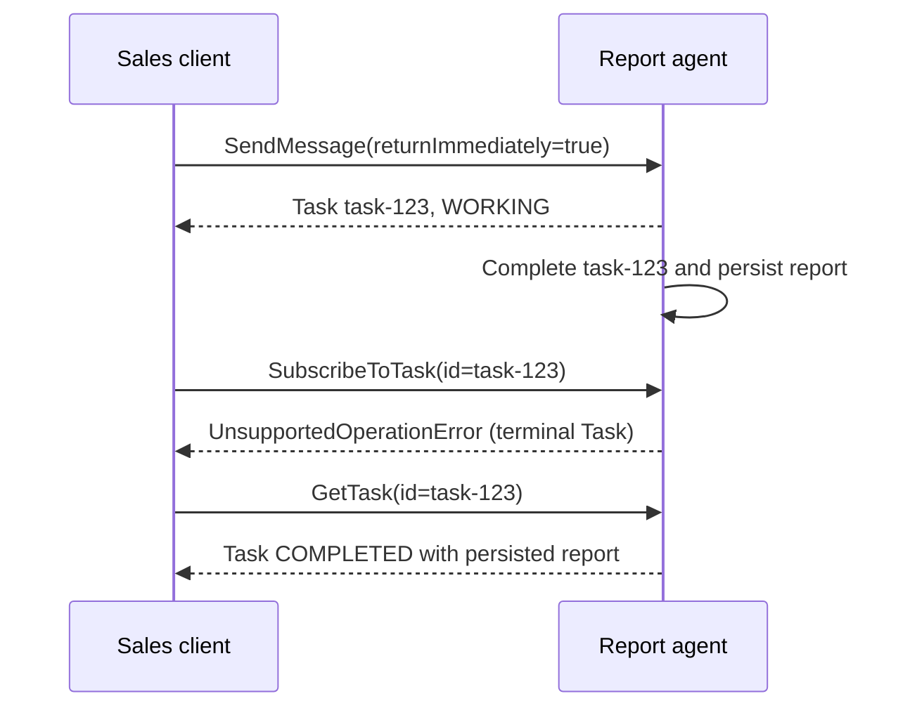
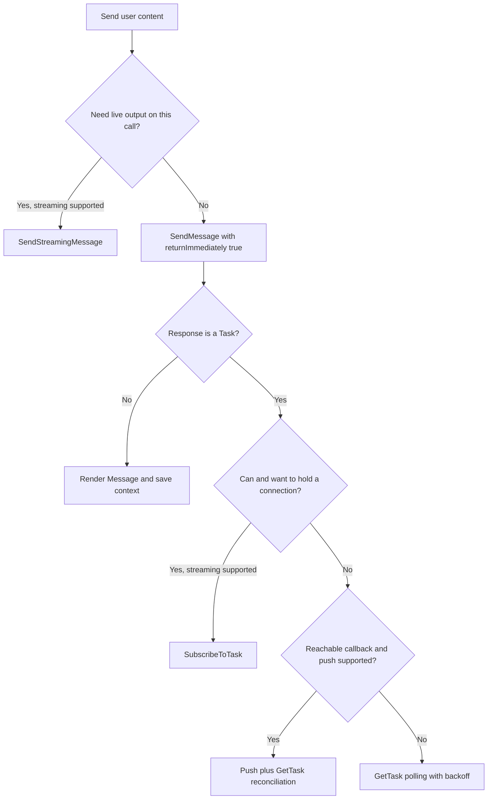

# Streaming and Push Notifications

> **Who this is for**: Engineers building A2A clients or servers that must deliver results from long-running agent tasks over unreliable connectivity — serverless functions, mobile clients, and tasks measured in hours. Before reading this, understand how a task moves through its states: **[Task Lifecycle](03_task_lifecycle.md)**.

A synchronous `SendMessage` works only when the agent finishes before the HTTP request times out. Real agent work — research, code generation, multi-tool orchestration — does not respect that budget. A2A protocol **1.0** (checked against specification release **1.0.1**) defines **Server-Sent Events (SSE)** streaming for connected clients and push notifications for disconnected clients.

---

If you cannot yet picture what the client sends or what arrives on the open response, read [Follow the Messages](00_client_server_walkthrough.md) first. It shows the complete request, annotated frames, a real local server/client, and how custom progress fits inside standard events.

## 1. SSE Streaming with `SendStreamingMessage`

`SendStreamingMessage` initiates or continues a task and keeps the HTTP response open as a `text/event-stream`. Instead of one final JSON-RPC response, the server emits a sequence of Server-Sent Events, each carrying a JSON-RPC 2.0 success response whose `result` is a `StreamResponse` with exactly one oneof field:

| `StreamResponse` field | Type                      | Meaning |
|------------------------|---------------------------|---------|
| `task`                 | `Task`                    | Initial snapshot of the created task |
| `message`              | `Message`                 | A direct agent reply; stream then closes |
| `statusUpdate`         | `TaskStatusUpdateEvent`   | Lifecycle change (`SUBMITTED` → `WORKING` → `COMPLETED`) |
| `artifactUpdate`       | `TaskArtifactUpdateEvent` | A produced artifact, possibly chunked |

Each streaming response object MUST contain exactly one of these. The stream follows one of two patterns:

```
Message-only:   message → [stream closes]
Task lifecycle: task → [statusUpdate / artifactUpdate]* → terminal/interrupted statusUpdate → [stream closes]
```

Two pieces drive client logic:

- **Task state** — v1.0 removed the old `final` flag. The stream ends when the task reaches a terminal state (`TASK_STATE_COMPLETED`, `TASK_STATE_FAILED`, `TASK_STATE_CANCELED`, `TASK_STATE_REJECTED`) or when the server intentionally pauses/returns control at an interrupted state.
- **`TaskArtifactUpdateEvent.append`** and **`lastChunk`** — let the agent stream a large artifact in pieces. `append: false` (or absent) starts a fresh artifact; `append: true` concatenates onto the artifact with the same `artifactId`. `lastChunk: true` marks the final segment of that artifact.

Example SSE stream (a code-generation task that streams its output file in two chunks):

```
event: message
data: {"jsonrpc":"2.0","id":"req-1","result":{"task":{"id":"t-9f3","contextId":"c-1","status":{"state":"TASK_STATE_SUBMITTED"}}}}

data: {"jsonrpc":"2.0","id":"req-1","result":{"statusUpdate":{"taskId":"t-9f3","contextId":"c-1","status":{"state":"TASK_STATE_WORKING"}}}}

data: {"jsonrpc":"2.0","id":"req-1","result":{"artifactUpdate":{"taskId":"t-9f3","contextId":"c-1","artifact":{"artifactId":"a-1","name":"main.py","parts":[{"text":"import os\n\ndef main():\n"}]},"append":false,"lastChunk":false}}}

data: {"jsonrpc":"2.0","id":"req-1","result":{"artifactUpdate":{"taskId":"t-9f3","contextId":"c-1","artifact":{"artifactId":"a-1","parts":[{"text":"    print('done')\n"}]},"append":true,"lastChunk":true}}}

data: {"jsonrpc":"2.0","id":"req-1","result":{"statusUpdate":{"taskId":"t-9f3","contextId":"c-1","status":{"state":"TASK_STATE_COMPLETED"}}}}
```

> **Rule**: A client MUST keep reading until the stream closes after a terminal/interrupted state, or until it sees the corresponding final task state via polling. Treating an early `TASK_STATE_WORKING` event as completion drops the actual result.

---

### Custom progress is data inside an event

Enabling `capabilities.streaming` permits streaming; it does not automatically forward LLM tokens, tool calls or framework callbacks. Your executor emits those observations deliberately through standard A2A carriers:

| Application observation | Standard carrier | Producer action |
|---|---|---|
| A stage/tool has completed | `statusUpdate` with `WORKING`, optional Message and namespaced metadata | `TaskUpdater.update_status(..., metadata=...)` |
| New report text or a model text chunk | `artifactUpdate`, same Artifact ID across chunks | `add_artifact(..., append=False)` first, then `append=True` |
| Structured result to retain with outputs | Artifact with structured `data` Part | Emit the result schema as output, then complete the Task when work is finished |

A custom application name such as `step_completed` belongs inside the agreed metadata schema; it is not a fifth `StreamResponse` payload or a new SSE label that ordinary A2A clients know how to process. Event metadata alone is not a durable progress history. The [worked custom-progress example](00_client_server_walkthrough.md#4-add-custom-progress-without-inventing-a-fifth-a2a-payload) shows the exact wire object, server SDK calls and client decoding loop. Use [extension discovery/activation](05_extensions_and_custom_bindings.md#custom-progress-on-a-standard-stream) when the additional schema needs negotiated semantics across independent implementations.

---

## 2. Subscribing to Existing Work

`SendStreamingMessage` sends content and starts receiving updates in the same call. `SubscribeToTask` sends no new user content: it attaches an observer to a Task that already exists. That can be the first subscription after a nonblocking send, a second observer, or a reconnect after a dropped stream. It does not execute or restart the work.

### First subscription after a nonblocking send

The client wants a report but does not want the initial HTTP request held open. It sends this JSON-RPC request with `A2A-Version: 1.0` to the card's advertised JSON-RPC URL:

```json
{
  "jsonrpc": "2.0",
  "id": "req-long-001",
  "method": "SendMessage",
  "params": {
    "message": {
      "messageId": "msg-long-001",
      "role": "ROLE_USER",
      "parts": [{"text": "Generate a large sales report for October 2026"}]
    },
    "configuration": {"returnImmediately": true}
  }
}
```

This server creates work and returns a Task snapshot:

```json
{
  "jsonrpc": "2.0",
  "id": "req-long-001",
  "result": {
    "task": {
      "id": "task-123",
      "contextId": "ctx-sales-001",
      "status": {"state": "TASK_STATE_WORKING"}
    }
  }
}
```

The Task ID is `result.task.id`; there is no separate top-level `taskId`. The client saves the returned IDs and inspects the state. This example is working, but it must also accept submitted, interrupted or already-finished work. A direct Message is still possible; `returnImmediately` does not force Task creation and has no effect on a direct reply.

If the Task needs observation and the card declares `capabilities.streaming: true`, the client sends a second request:

```json
{
  "jsonrpc": "2.0",
  "id": "req-subscribe-001",
  "method": "SubscribeToTask",
  "params": {"id": "task-123"}
}
```

The HTTP response has `Content-Type: text/event-stream`. Its first event contains the current Task snapshot; later events describe output and state changes. A short illustrative stream is:

```text
data: {"jsonrpc":"2.0","id":"req-subscribe-001","result":{"task":{"id":"task-123","contextId":"ctx-sales-001","status":{"state":"TASK_STATE_WORKING"}}}}

data: {"jsonrpc":"2.0","id":"req-subscribe-001","result":{"artifactUpdate":{"taskId":"task-123","contextId":"ctx-sales-001","artifact":{"artifactId":"art-summary","parts":[{"text":"October sales: $150,000"}]},"lastChunk":true}}}

data: {"jsonrpc":"2.0","id":"req-subscribe-001","result":{"statusUpdate":{"taskId":"task-123","contextId":"ctx-sales-001","status":{"state":"TASK_STATE_COMPLETED"}}}}
```

The `data:` lines above are SSE fields, separated by blank lines. The client accumulates Artifacts by ID and uses the Task state to decide whether to finish, request input or initiate authorization. An `INPUT_REQUIRED` notification needs an answer through a new `SendMessage` addressed to the same Task; listening alone cannot answer it. For a Task that is already interrupted in the initial snapshot, act on that snapshot immediately rather than waiting for a duplicate status update.

### Completion can happen between the two requests

The initial response and the subscription are not one atomic operation. The report can finish in the gap, as the diagram shows:



An already-terminal Task rejects `SubscribeToTask`. Recover its persisted state with `GetTask`; repeating the subscription or resending the report Message is not the recovery. A preliminary `GetTask` cannot remove the race because completion can happen just after that read. If a subscription error is due to missing capability, authorization or an unknown Task, handle that actual cause; do not classify every error as successful completion. These are the [normative subscription semantics](https://a2a-protocol.org/latest/specification/#316-subscribe-to-task).

### Reconnect without restarting the Task

An SSE connection can break after the client has already captured the Task ID. Reconnect with bounded backoff using `SubscribeToTask` on that ID. If the Task finished during the gap, use the same `GetTask` recovery branch above. If it is still running, the new subscription gives a current snapshot and future events.

SSE is not a durable event log: missing deltas are not guaranteed to replay. Reconcile persisted Artifacts using the initial Task snapshot or `GetTask`, replacing the local output snapshot before applying subsequent deltas. Coordinate reads and buffering so an older read cannot overwrite newer events. A chunk the server never persisted cannot be recovered by reconnecting alone. The [Python client](../03_python/03_building_a_client.md) demonstrates snapshot and event handling; the [production continuation](../05_production/03_scaling_deployment.md#3-long-running-tasks--decouple-execution-from-the-request) explains durable execution and shared events.

---

## 3. The `capabilities.streaming` Flag

SSE is optional. A client MUST check the Agent Card before calling `SendStreamingMessage`:

```json
{
  "name": "research-agent",
  "capabilities": {
    "streaming": true,
    "pushNotifications": true
  }
}
```

If `capabilities.streaming` is `false` or absent, the agent rejects `SendStreamingMessage` and `SubscribeToTask` with an `UnsupportedOperationError`. To poll work while it runs, call `SendMessage` with `configuration.returnImmediately: true`; the initial response is typically a `Task` in `TASK_STATE_SUBMITTED` or `TASK_STATE_WORKING`, which the client then reads with `GetTask`. The default blocking call may not return until a terminal or interrupted state, leaving no in-progress result to poll.

> **Rule**: Never hardcode the assumption that an agent streams. Capability discovery happens per-agent, at the Agent Card, before the first request.

---

## 4. Push Notifications and Webhooks

SSE assumes the client can hold a connection open for the entire task. That assumption fails for:

- **Serverless clients** — a Lambda or Cloud Function is billed per-millisecond and killed after minutes; it cannot babysit an hours-long SSE stream.
- **Mobile apps** — the OS suspends background sockets aggressively. The public webhook belongs on your backend; that backend validates the A2A push and forwards a notification through APNs, FCM, or another mobile push channel.
- **Very-long-running tasks** — a task that takes six hours has no business pinning a TCP connection for six hours on either side.

For these, A2A inverts the flow: the client registers a **webhook**, disconnects entirely, and the agent **POSTs task updates to that URL** when they happen. The client wakes only on real progress.

This sequence shows who owns the public callback for `t-9f3` and why a mobile app does not receive A2A webhook POSTs directly.

```mermaid
sequenceDiagram
  participant App as Mobile app
  participant Backend as client.example.com backend
  participant Agent as agent.example.com
  App->>Backend: Start task t-9f3
  Backend->>Agent: CreateTaskPushNotificationConfig(t-9f3, webhook URL)
  Agent-->>Backend: config id push-42
  Note over App,Agent: App disconnects while t-9f3 runs
  Agent->>Backend: POST /a2a/webhook (t-9f3 statusUpdate)
  Backend->>Backend: Verify auth and task ownership; persist idempotently
  Backend-->>Agent: 204 No Content
  Backend-->>App: Mobile notification or later status fetch
```

The backend registers and owns the HTTPS callback. It checks the incoming authentication and Task ownership before storing the update or alerting the app. The callback is a delivery signal; `GetTask` remains the reconciliation path if the POST is missed.

This HTTP+JSON example creates a config for an existing Task. Credentials shown as angle-bracket placeholders come from a secret manager at runtime; they never belong in source or logs.

```http
POST /tasks/t-9f3/pushNotificationConfigs HTTP/1.1
Host: agent.example.com
Content-Type: application/a2a+json
A2A-Version: 1.0
Authorization: Bearer <a2a-client-token>

{
  "url": "https://client.example.com/a2a/webhook",
  "authentication": {
    "scheme": "Bearer",
    "credentials": "<webhook-bearer-secret>"
  }
}
```

Success is `200 OK` with an assigned config ID:

```json
{
  "id": "push-42",
  "taskId": "t-9f3",
  "url": "https://client.example.com/a2a/webhook",
  "authentication": { "scheme": "Bearer" }
}
```

- **`url`** — the HTTPS endpoint the agent POSTs to.
- **`authentication`** — how the agent authenticates each outbound HTTP request. The receiving backend validates this header before parsing the body.

The first callback might be:

```http
POST /a2a/webhook HTTP/1.1
Host: client.example.com
Authorization: Bearer <webhook-bearer-secret>
Content-Type: application/a2a+json

{"statusUpdate":{"taskId":"t-9f3","contextId":"c-1","status":{"state":"TASK_STATE_WORKING"}}}
```

The receiver validates the header and expected `taskId`, persists the update idempotently, and returns `204 No Content`. A `401`/`403` at the callback means authentication failed; connection/DNS errors mean the endpoint is not publicly reachable; `PushNotificationNotSupportedError` means the card capability was absent; `TaskNotFoundError` means the config was attached to an inaccessible or unknown Task.

The POST body is exactly one `StreamResponse` — `task`, `message`, `statusUpdate`, or `artifactUpdate`. It does not echo the config's legacy `token` field. Configs can also be retrieved, listed, and deleted, and all operations are gated by `capabilities.pushNotifications`.

SSE is connection-shaped: the client holds the channel. Push is event-shaped: the agent initiates a new authenticated HTTP request for each update.

---

## 5. Securing the Webhook

A webhook URL is a publicly reachable endpoint that accepts POSTs and acts on them. Both sides must harden it.

**The receiving client MUST validate every notification:**

- ⚠️ **Enforce the configured HTTP authentication.** For an opaque bearer secret, compare it in constant time. For a JSON Web Token (JWT), configure trusted issuers and JSON Web Key Set (JWKS) URLs, allowlist the signing algorithm instead of accepting `alg` from the token, then verify signature, `exp`, `iat`, `aud`, `iss`, and subject as required. The callback body contains no echoed config token.
- ⚠️ **Treat the body as untrusted input.** The `taskId` and artifact contents could be attacker-controlled. Look up the task in your own store; never act on a `taskId` you do not recognize.

**The agent MUST protect against SSRF when POSTing:**

- ⚠️ An agent that blindly POSTs to any client-supplied `url` is an SSRF gadget. A malicious client could register `http://169.254.169.254/...` (cloud metadata) or `http://10.0.0.5/internal`. The agent MUST reject non-HTTPS URLs, resolve the hostname and block private / link-local / loopback IP ranges, and ideally require the webhook host to be pre-allowlisted.
- The agent MUST authenticate *to* the webhook using the `authentication` config — sign a JWT or present the agreed credential — so the receiver can distinguish a real notification from a forged one.

For the full SSRF defense checklist (DNS-rebinding, IP-range blocklists, egress proxies), see [Security Hardening](../05_production/02_security_hardening.md).

> **Rule**: A webhook without authenticated HTTP delivery is an open input endpoint. Validate the configured authentication and expected Task ownership on every request before acting on the body.

---

## 6. Choosing a Delivery Mechanism

There are three update mechanisms: polling, streaming and push. Streaming has two entry operations, depending on whether the same call also sends user content.

| Workflow | How observation starts | Connection / infrastructure | Required capability |
|---|---|---|---|
| Nonblocking send + polling | `SendMessage(returnImmediately=true)`, then bounded `GetTask(id)` calls | Short requests; client controls interval/backoff | No optional delivery capability |
| Send and stream | `SendStreamingMessage` sends content and yields updates | Open SSE response for JSON-RPC/HTTP+JSON | `streaming` |
| Subscribe to known work | `SendMessage(returnImmediately=true)`, then `SubscribeToTask(id)`; also useful for reconnects | Open SSE response; handle completion before subscription | `streaming` |
| Push notifications | Register `CreateTaskPushNotificationConfig` for a Task, or include `configuration.taskPushNotificationConfig` in the send | Client backend owns a reachable HTTPS callback; no persistent observer connection | `pushNotifications` |

Plain `SendMessage` without `returnImmediately` is blocking by default: it waits for a terminal or interrupted state, rather than providing an in-progress monitoring channel. It can still return a completed Task with Artifacts. `returnImmediately` is ignored by streaming operations.

Choose by reachability and the updates you need, not by a fixed duration cutoff. Polling can monitor an hours-long Task; streaming can monitor one as long as the client and infrastructure sustain the connection. Push is useful when a backend needs updates while the initiating client is offline. A browser or mobile app normally delegates webhook receipt to its backend.

This decision tree keeps creation separate from monitoring:



Inspect a returned Task before choosing the next branch: terminal means render the available result, interrupted means take the required action, and active means observe progress. If push is required from the first moment, include the callback config in the initial send; registering it later cannot be assumed to replay earlier notifications. For polling in the SDK, set both `streaming=False` and `polling=True`; see the [Python polling example](../03_python/03_building_a_client.md#6-polling-a-non-streaming-task).

`returnImmediately` changes when the response is delivered, not how durable execution is. The server SDK can run work asynchronously in process; surviving a process restart also requires persisted work/checkpoints and a recovery mechanism. A TaskStore row by itself does not schedule or resume execution. The [worker design](../05_production/03_scaling_deployment.md#3-long-running-tasks--decouple-execution-from-the-request) develops that boundary.

---

## 7. Failure Modes

| Failure                        | Symptom                                   | Mitigation |
|--------------------------------|-------------------------------------------|------------|
| SSE connection drops mid-task  | Stream ends before a terminal/interrupted state | `SubscribeToTask` with bounded backoff; if already terminal, `GetTask`; reconcile persisted Artifacts |
| Webhook endpoint down          | Agent's POST fails or times out           | Retry policy is implementation-defined; client polls `GetTask` as the reliable reconciliation path |
| Duplicate notifications        | Same event POSTed more than once          | Make webhook handling **idempotent** — dedupe on `taskId` + event identity (JWT `jti` if signed); a redelivered "completed" must be a no-op |
| Out-of-order notifications     | `TASK_STATE_WORKING` arrives after `TASK_STATE_COMPLETED` | Trust task **state**, not arrival order — never regress a task from a terminal state; use timestamps in `TaskStatus` to discard stale events |
| Stale / replayed notification  | Old captured POST replayed by an attacker | Reject notifications past a freshness window (`iat` check); track seen `jti` values |
| Stream never closes after no events | Agent crashed or stream silently stalled  | Client-side timeout bounded by the task's expected max duration, then `GetTask` to read the authoritative state |

⚠️ The server guarantees at least one delivery attempt per configured webhook, not a retry schedule. It may retry with backoff and may stop after repeated failures. When delivery is uncertain — a drop, duplicate, reorder, or exhausted retry policy — fall back to `GetTask` and reconcile.

> **Rule**: Design every notification handler to be idempotent and ordering-tolerant. Networks reorder, retry, and replay; a correct client assumes all three will happen.

## What's changing

The [A2A roadmap](https://github.com/a2aproject/A2A/blob/main/docs/roadmap.md) (checked 2026-10-12) proposes bidirectional streaming for active multi-turn exchange. This lesson's 1.0 SSE flows from server to client; it does not provide that planned bidirectional behavior.

## Recap and check yourself

- Streaming holds an SSE connection and can deliver chunks while the client is present.
- Push sends authenticated POSTs to a public backend when a client cannot remain connected; polling reads state without either channel.
- A dropped stream or callback does not end the Task. Reattach where possible and use `GetTask` to reconcile persisted state.
- Verify callback authentication and Task ownership before applying updates; dedupe retries and refuse stale state regressions.

**Q: The `t-9f3` SSE stream drops after the first artifact chunk. A second chunk is emitted during the gap. Does `SubscribeToTask` guarantee replay of it?**

<details><summary>Answer</summary>

No. A subscription gives a current snapshot and future events. Fetch `GetTask` to reconstruct artifacts that the server persisted; a chunk never persisted by the server cannot be recovered by reconnecting alone.

</details>

**Q: A webhook delivers `TASK_STATE_WORKING` after your backend stored `TASK_STATE_COMPLETED`. What state should the app show?**

<details><summary>Answer</summary>

Keep `COMPLETED`. Delivery can reorder, whereas a terminal Task cannot regress. If uncertain, read the authoritative Task with `GetTask`.

</details>

**Q: `SendMessage(returnImmediately=true)` returned a working Task, but the next `SubscribeToTask` rejects it as terminal. Should you resend the original Message?**

<details><summary>Answer</summary>

No. The Task completed between requests. Read the same Task ID with `GetTask` and inspect its terminal state and persisted outputs. Resending content can create duplicate work; a terminal-subscription error does not mean the original request was lost.

</details>

**Try it.** The backend loses its connection after receiving the first chunk of `a-1`. Write the recovery order. Hint: distinguish a live subscription from persisted Task state.

<details><summary>Worked solution</summary>

Subscribe to `t-9f3` with bounded backoff. If it completed during the gap, read it with `GetTask` and render its persisted Artifacts. Otherwise replace local output with the new subscription snapshot and then apply future deltas. If an additional GetTask read is needed, coordinate it with incoming updates to avoid overwriting newer state. A chunk never persisted by the server cannot be recovered; report incomplete output rather than inventing it.

</details>

---

**Next**: [Part 1: SDK Setup](../03_python/01_sdk_setup.md)
