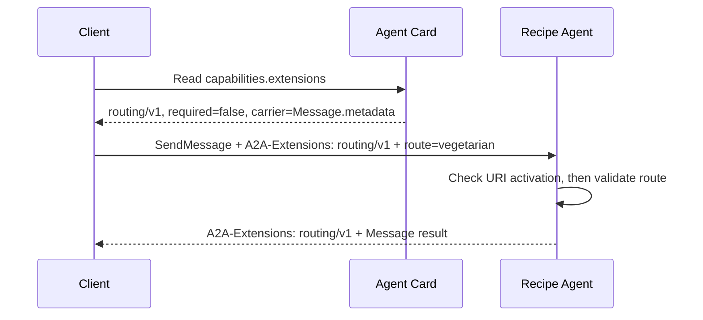

# Extensions & Custom Protocol Bindings

> **Who this is for**: Implementers who need domain-specific metadata, behavior, or transport while preserving the A2A 1.0 core contract.

An **extension** changes semantics above an existing binding. A **custom protocol binding** maps A2A operations onto a different transport. If HTTP+JSON still carries your message but a `DataPart` gains a purchase mandate, that is an extension; if A2A operations are mapped onto a new message bus, that is a binding.

## Declare support in the Agent Card

Extensions are URI-identified `AgentExtension` entries under `capabilities.extensions`:

```json
{
  "capabilities": {
    "extensions": [{
      "uri": "https://example.com/a2a/extensions/routing/v1",
      "description": "Selects a validated application route",
      "required": false,
      "params": {"carrier": "Message.metadata"}
    }]
  }
}
```

`required: true` means a client must understand and activate the extension to interact correctly. Use it only when the baseline interaction cannot work without the extension. A data-only annotation normally remains optional.

## Activate per request: one routing decision

Declarations describe capability; they do not activate behavior. For HTTP transports, the client sends a comma-separated `A2A-Extensions` service parameter and the server echoes only the URIs it activated:

Suppose the Recipe Agent routes a request to the `vegetarian` recipe queue. Its card advertises the optional routing URI above. The client selects the card's JSON-RPC interface and sends this complete illustrative request; this private extension's `params.carrier` declares where its own schema expects `route`.

```http
POST /a2a HTTP/1.1
Host: agent.example.com
A2A-Version: 1.0
A2A-Extensions: https://example.com/a2a/extensions/routing/v1
Content-Type: application/json
Authorization: Bearer <a2a-client-token>

{"jsonrpc":"2.0","id":"route-1","method":"SendMessage","params":{"message":{"messageId":"msg-route-1","role":"ROLE_USER","parts":[{"text":"Find a dinner recipe"}],"metadata":{"route":"vegetarian"}}}}
```

The request and response cross three gates in order. Follow the same URI and route value in the diagram.



The card only says the extension is available. The header requests activation, and the server's response header echoes the URI it actually activated. The server then validates `route` under the extension's schema and policy before selecting the queue. The echo confirms activation, not that arbitrary metadata is trustworthy. For this illustrative private extension, an unknown route is rejected by its defined validation error; it must not quietly route to a privileged queue.

The response header makes the activated URI observable even when the Message result has no routing-specific field (illustrative JSON-RPC success excerpt):

```http
HTTP/1.1 200 OK
Content-Type: application/json
A2A-Extensions: https://example.com/a2a/extensions/routing/v1

{"jsonrpc":"2.0","id":"route-1","result":{"message":{"messageId":"msg-recipe-1","role":"ROLE_AGENT","parts":[{"text":"Try a lentil stew."}]}}}
```

The request may then carry extension data in the location its specification defines, commonly a core `metadata` map or a schema-defined `DataPart`. The server validates the carrier before use. If the optional URI is absent from the request header, `route: vegetarian` alone does not activate routing and the server applies baseline behavior. If the URI is unsupported, an optional extension may be ignored and is absent from the response echo; the client must not assume routing happened. If the card marks it `required: true` and the client omits activation, the server fails with `ExtensionSupportRequiredError`. Never silently substitute another extension version. These gates follow the [A2A extension declaration and service-parameter rules](https://a2a-protocol.org/latest/specification/) (checked 2026-10-12).

## Dependencies and versioning

An extension specification must define its URI, carriers and schemas, flows/methods, errors, authorization, and required dependencies. The client activates the extension plus all required dependencies. Give a breaking revision a new URI such as `/v2`; the URI is the negotiated version.

Extensions cannot add fields directly to core protobuf messages or invent enum values. Put additional data in defined metadata/data carriers. New RPC methods, if any, must pass through the same authentication, authorization, rate limits, and tenant scoping as core methods.

## When a custom binding is justified

Create a custom binding only when the transport mapping itself is different. Give it a stable identifier, define every core operation and error mapping, version header/service parameter behavior, streaming/cancellation semantics, security, and interoperability tests. Clients skip an unsupported binding and select another advertised `supportedInterfaces` entry.

Official and experimental artifacts follow the A2A [extension and binding governance](https://a2a-protocol.org/latest/topics/extension-and-binding-governance/); private URIs remain valid but are your compatibility responsibility.

> **Key insight**: Discovery declares an extension, the request activates it, and a validated carrier conveys its data. Treat those as three separate gates; an extension URI appearing in payload metadata is not proof that it was negotiated.

## Recap and decision exercise

- The card advertises the URI and whether activation is required; it does not activate a request.
- The request header asks for activation, and the response echo reports what the server activated.
- The carrier supplies data only after activation and schema/policy validation. A custom binding instead changes the operation-to-transport mapping.

**Q: The card lists optional routing/v1, but the client sends `metadata.route = vegetarian` without `A2A-Extensions`. Should routing run?**

<details><summary>Answer</summary>

No. Discovery and request activation are separate gates. The metadata has no negotiated routing semantics, so the server follows baseline behavior; using it for routing would let unnegotiated input steer the agent.

</details>

---

**Next**: [Protocol-Version Migration](06_version_negotiation_and_migration.md)
