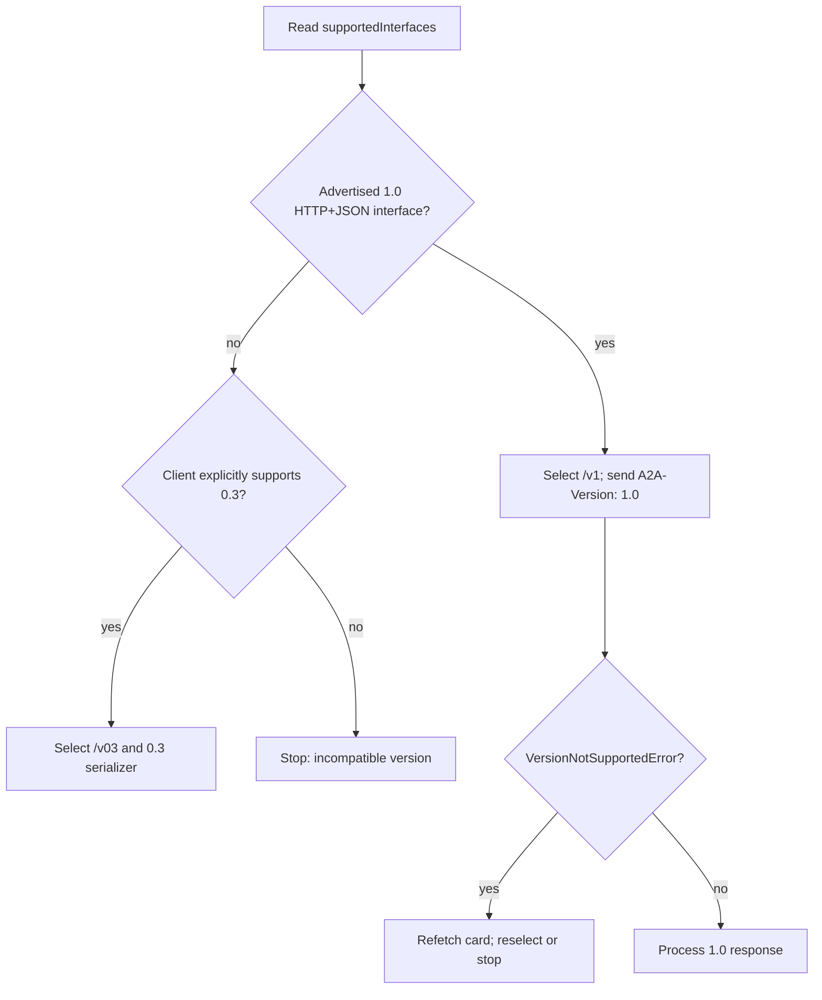

# Protocol-Version Negotiation & Migration

> **Who this is for**: Teams rolling A2A 1.0 into a fleet that still contains v0.3 clients or servers.

Wire compatibility is declared as Major.Minor (`1.0`), while this repository is checked against specification patch release 1.0.1. The client selects an advertised interface/version and sends `A2A-Version: 1.0` on every HTTP request. An empty header is interpreted as legacy `0.3`; it is not a safe way to request “latest.”

## The request contract

This is the HTTP+JSON binding; its A2A JSON media type differs from the `application/json` used by JSON-RPC examples.

```http
POST /message:send HTTP/1.1
Host: agent.example
A2A-Version: 1.0
Content-Type: application/a2a+json
```

The server either processes that version or returns the binding-specific `VersionNotSupportedError`. Clients must not retry the same interface without a version or reinterpret a 1.0 response as 0.3.

## A dual-stack selection trace

Suppose the cached Agent Card contains these two `supportedInterfaces` entries (an excerpt from a larger card):

```json
[
  {"url":"https://agent.example/v1","protocolBinding":"HTTP+JSON","protocolVersion":"1.0"},
  {"url":"https://agent.example/v03","protocolBinding":"HTTP+JSON","protocolVersion":"0.3"}
]
```

A 1.0 client selects `/v1`, serializes a 1.0 Message, and sends `A2A-Version: 1.0`. If `/v1` has been retired since the card was cached, a version-not-supported response means the *selected endpoint and cached advertisement* disagree. The client refetches the card, then selects again from what is currently advertised. It does not remove the header and retry `/v1`: an absent header selects the legacy interpretation and could deserialize the same bytes under a different schema. The [A2A specification's version negotiation and HTTP+JSON rules](https://a2a-protocol.org/latest/specification/) describe the service parameter and binding (checked 2026-10-12).

Follow the decision branches when a mixed fleet changes under a client.



The 0.3 branch requires a client with a tested 0.3 serializer. A 1.0-only client stops even if a freshly fetched card offers `/v03`; H never means silently dropping `A2A-Version` on the same URL.

## A staged v0.3 → v1.0 rollout

1. Inventory clients, servers, cards, bindings, and SDK pins. Record which 0.3-only operations or field shapes are still used.
2. Add contract tests for both versions before changing routing. Keep separate serializers/models at the boundary; do not mix 0.3 and 1.0 objects inside business logic.
3. Publish explicit `supportedInterfaces` entries for the versions you truly serve. Prefer separate URLs when that makes routing and retirement observable.
4. Upgrade servers first while retaining a measured compatibility path. Require clients to send the version explicitly and emit metrics by version/interface/error.
5. Upgrade clients to select a compatible card interface and send the service parameter on every request.
6. Drain 0.3 traffic, announce a deadline, then remove the old interface and compatibility code. A stale card should fail clearly, not fall through to another schema.

## Mixed-fleet test matrix

| Client | Server | Expected result |
|---|---|---|
| 1.0 | advertises/accepts 1.0 | Success; response uses 1.0 shapes |
| 1.0 | 0.3 only | Client selects an explicitly supported 0.3 compatibility path or stops |
| 0.3 | dual-stack | Legacy path works and is counted |
| any | unsupported version header | Binding-native version-not-supported failure |
| any | stale interface URL/version | Clear failure; refetch card, then reselect |

Run lifecycle, streaming, push, auth, and error tests for each advertised version. A successful `SendMessage` alone does not prove that continuation or task resource operations are compatible.

> **Key insight**: Version negotiation is explicit selection, not hopeful fallback. Advertise only what the endpoint implements, send the chosen version on every call, and make legacy traffic measurable before removing it.

## What's changing

The [A2A roadmap](https://github.com/a2aproject/A2A/blob/main/docs/roadmap.md) (checked 2026-10-12) proposes 1.1 task timeline and event filtering semantics. A proposed version is not an advertised compatible interface; keep the explicit 1.0/0.3 selection and contract tests until a release and migration rules exist.

## Decision exercise

**Q: A cached card advertises `/v1`, but the endpoint returns `VersionNotSupportedError`. A refetched card advertises only `/v03`. What should a 1.0-only client do?**

<details><summary>Answer</summary>

Stop with an incompatible-version error. The refetch repairs stale discovery, but it does not add a 0.3 serializer or tested behavior to this client. Dropping the version header or reusing 1.0 shapes at `/v03` would reinterpret a request under the wrong contract.

</details>

---

**Next**: [Agent Payments with AP2](07_agent_payments_ap2.md)
