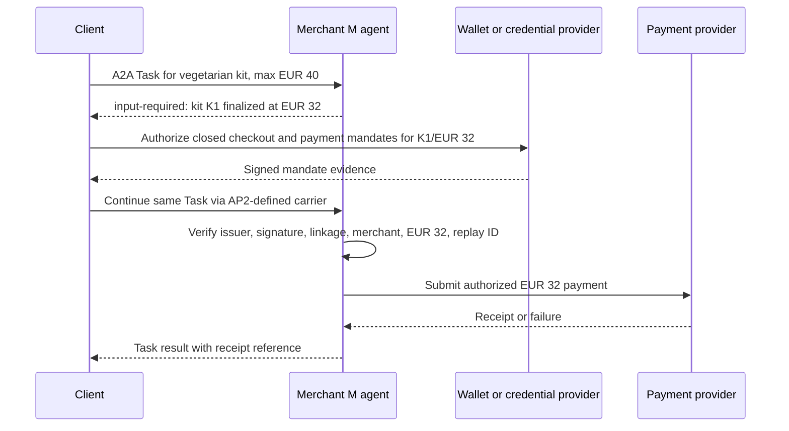

# Agent Payments over A2A with AP2

> **Who this is for**: Readers evaluating payment-capable agent flows. This is a bounded integration map, not payment, legal, or compliance advice.

The Agent Payments Protocol (AP2) adds verifiable authorization evidence to commerce interactions. A2A still carries discovery, messages, tasks, status, and artifacts; AP2 defines the payment-specific roles, credentials, and mandates layered onto that exchange. Do not put raw card numbers, wallet secrets, or reusable payment credentials in ordinary text parts.

## The two mandate families

- A **Checkout Mandate** records the negotiated goods and purchase constraints. An open mandate expresses goals/limits; a closed mandate binds authorization to a finalized checkout.
- A **Payment Mandate** authorizes payment against a payment instrument. Its closed form binds the authorized amount to the finalized checkout.

These are verifiable digital credentials: cryptographically signed evidence that downstream participants validate under AP2 rules. They supplement normal A2A caller authentication; one does not replace the other.

For example, a shopper authorizes an open constraint: a vegetarian dinner kit from Merchant M, at most EUR 40. That constraint does not identify a finished cart or authorize an arbitrary charge. The merchant proposes kit K1 for EUR 32. The finalized cart is then bound by a closed Checkout Mandate; the payment authority is a closed Payment Mandate for EUR 32 linked to that checkout. The merchant and payment participants validate the signed objects under the applicable [AP2 mandate rules](https://github.com/google-agentic-commerce/AP2/blob/main/docs/index.md) (checked 2026-10-12). If the cart changes to EUR 39 after signing, being under the earlier EUR 40 ceiling is insufficient: the closed authorization was for the finalized EUR 32 transaction. A new authorization is required.

## A bounded A2A task flow

The diagram locates the A2A pause and the AP2 authority check in the same checkout. Its arrows are a conceptual handoff, not a substitute for AP2's versioned schemas and role-specific API definitions.

The wallet or credential provider creates verifiable evidence; the merchant cannot derive that authority from the client's plain-language claim. The exact AP2 carrier and participant handoffs depend on the selected AP2 flow. A2A supplies the same Task identity and observable status through the pause and result. If Merchant M changes the requested charge to EUR 39 after the mandates were signed for EUR 32, the linkage/amount check fails before submission to P. The Task should report an explicit rejection or request fresh authorization, according to the application flow; it must not return a paid receipt.

1. The merchant agent advertises the AP2 extension URI and supported payment capability in its Agent Card.
2. The client activates that exact extension version using `A2A-Extensions` and sends schema-valid AP2 data in the extension-defined carrier.
3. The task may pause in `input-required` or `auth-required` while a human, wallet, or credential provider completes authorization out of band.
4. The agent verifies issuer, signature, audience, expiry, mandate linkage, amount/currency, merchant, and replay identifiers before advancing.
5. The result returns receipts/references and task status—not reusable payment secrets. Audit logs record identifiers and decisions, not credential bodies.

Failure must be explicit: unsupported extension/version, invalid or expired credential, mandate mismatch, amount change, replay, denied authorization, and payment-provider failure are distinct outcomes. Never “upgrade” an open mandate to a closed one based on model text.

**Boundary check:** If K1's final amount rises to EUR 39 while the signed closed Payment Mandate still says EUR 32, should the merchant charge because EUR 39 is below the open EUR 40 limit? No. The open limit constrained shopping, while the closed payment authorization binds a specific finalized transaction. The merchant must reject this mismatch and obtain fresh authorization before charging.

Use the [AP2 documentation and A2A samples](https://github.com/google-agentic-commerce/AP2/blob/main/docs/index.md) as the normative owner for schemas and role flows; this note owns only the boundary with the A2A lifecycle.

> **Key insight**: A2A transports the collaboration; AP2 supplies verifiable payment intent and authorization. Payment authority must come from validated mandates and policy, never from an agent's natural-language assertion.

---

**Next**: [Python SDK Setup](../03_python/01_sdk_setup.md)
