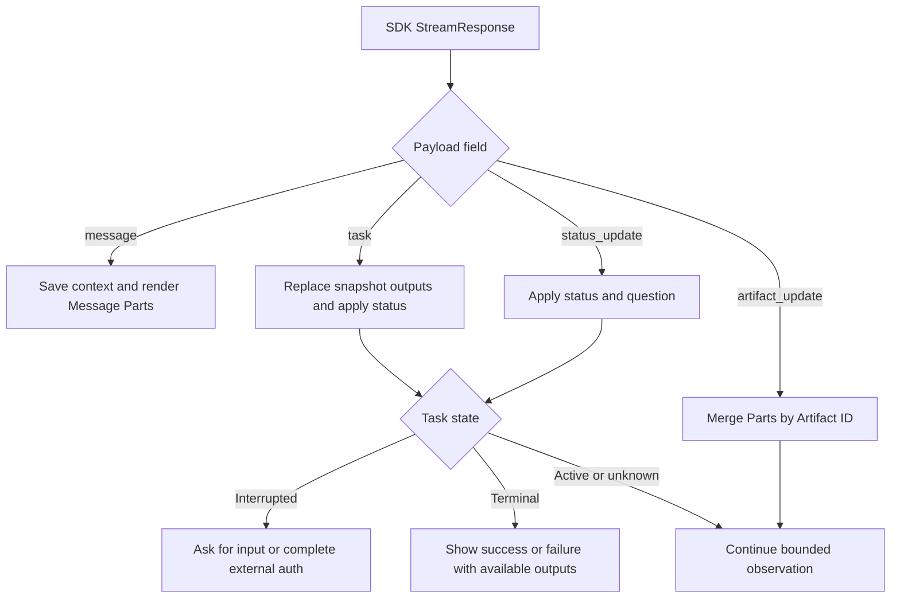

# Building an A2A Client with `a2a-sdk`

<!-- length-justification: This implementation note keeps discovery, transport selection, send/stream recovery, authentication, and cleanup in one client lifecycle so identity captured in one stage is visible in the next. -->

> **Who this is for**: Python engineers who have built or read about an A2A server and now need to *call* one. You know `async`/`await` and `httpx`. By the end you can discover a remote agent, send it work, stream results, resume an `input-required` pause, and attach credentials — all against `a2a-sdk==1.1.2`.

Before reading this, understand the server side: **[Building a Server](02_building_a_server.md)**. The streaming event model is covered in **[Streaming & Push](../02_protocol/04_streaming_and_push.md)**.

> **Rule**: Everything here targets `a2a-sdk` **`1.1.2`**. The wire model uses Protocol Buffers types. A protobuf **`oneof`** is a group in which exactly one field may be active, so response code uses `HasField()` before reading `message`, `task`, `status_update`, or `artifact_update`. **gRPC** is A2A's typed remote-procedure-call binding over HTTP/2; **Server-Sent Events (SSE)** is the HTTP stream used by JSON-RPC and HTTP+JSON.

For exact request bodies, the open SSE response, and custom progress before the SDK abstraction, read [Follow the Messages](../02_protocol/00_client_server_walkthrough.md). Its live lab prints outgoing Messages and every received event.

## Quick start: discover, create, send, interpret

Start the echo server from [Building a Server](02_building_a_server.md), then save this as `echo_client.py`:

```python
import asyncio
from uuid import uuid4

import httpx

from a2a.client import A2ACardResolver, ClientConfig, ClientFactory
from a2a.types import Message, Part, Role, SendMessageRequest, TaskState
from a2a.utils import TransportProtocol


async def main() -> None:
    async with httpx.AsyncClient(timeout=10.0) as http:
        card = await A2ACardResolver(
            httpx_client=http, base_url="http://127.0.0.1:9999"
        ).get_agent_card()
        client = ClientFactory(ClientConfig(
            httpx_client=http,
            supported_protocol_bindings=[TransportProtocol.JSONRPC],
        )).create(card)

        request = SendMessageRequest(message=Message(
            message_id=f"msg-{uuid4()}",
            role=Role.ROLE_USER,
            parts=[Part(text="hello")],
        ))
        async with client:
            async for event in client.send_message(request=request):
                if event.HasField("message"):
                    print("reply:", event.message.parts[0].text)
                elif event.HasField("task"):
                    print("task:", TaskState.Name(event.task.status.state))
                    for artifact in event.task.artifacts:
                        print("artifact:", artifact.parts[0].text)


asyncio.run(main())
```

Run `python echo_client.py`. The baseline server produces `task: TASK_STATE_COMPLETED` and `artifact: echo: hello`. A card-resolution error means the server or well-known route is unavailable; `no compatible transports found` means the card and `ClientConfig` share no binding.

> **Production:** this baseline is deliberately local and unauthenticated. Streaming recovery, secure gRPC, credentials, timeouts, and bounded retries follow after the working round trip.

---

## 1. The Client Pipeline

A client is built in three stages. You rarely touch the transport directly — the **`ClientFactory`** picks it from the agent's card.

```
  base URL
     │
     ▼
┌──────────────────┐   GET /.well-known/agent-card.json
│ A2ACardResolver  │ ─────────────────────────────────────►  AgentCard
└──────────────────┘
     │ AgentCard
     ▼
┌──────────────────┐   reads card.supported_interfaces,
│  ClientFactory   │   matches against ClientConfig bindings,
│  + ClientConfig  │   selects JSONRPC / HTTP+JSON / gRPC transport
└──────────────────┘
     │ Client  (transport-agnostic)
     ▼
┌──────────────────┐   send_message()  -> AsyncIterator[StreamResponse]
│      Client      │   get_task()      -> Task
│                  │   subscribe()     -> AsyncIterator[StreamResponse]
└──────────────────┘
```

The public surface lives in `a2a.client`:

```python
from a2a.client import (
    A2ACardResolver,      # base URL  -> AgentCard
    ClientFactory,        # AgentCard -> Client
    ClientConfig,         # transport prefs, streaming, polling, httpx client
    Client,               # transport-agnostic abstract client
    create_client,        # one-shot convenience: URL/card -> Client
    AuthInterceptor,      # attaches credentials to every outbound call
    CredentialService, InMemoryContextCredentialStore,
    A2AClientError, A2AClientTimeoutError, AgentCardResolutionError,
)
```

The `Client` is transport-agnostic by construction. The same `send_message` call runs over JSON-RPC, HTTP+JSON, or gRPC according to the card and `ClientConfig`.

---

## 2. Resolving an Agent Card

`A2ACardResolver` fetches and parses the card. It needs an `httpx.AsyncClient` you own — the SDK never creates a global HTTP client behind your back.

```python
import httpx
from a2a.client import A2ACardResolver, AgentCardResolutionError

async def discover(base_url: str) -> None:
    # One httpx client, owned by you, reused for the card fetch *and* the
    # client below. Always set an explicit timeout.
    async with httpx.AsyncClient(timeout=30.0) as http:
        resolver = A2ACardResolver(httpx_client=http, base_url=base_url)
        try:
            # No path arg => fetches <base_url>/.well-known/agent-card.json
            card = await resolver.get_agent_card()
        except AgentCardResolutionError as e:
            # Raised for HTTP errors, network failures, bad JSON, or a
            # payload that doesn't validate against the AgentCard schema.
            print(f"Could not resolve agent: {e}")
            return

        print(f"Agent: {card.name} v{card.version}")
        print(f"Streaming: {card.capabilities.streaming}")
        for iface in card.supported_interfaces:
            print(f"  {iface.protocol_binding} -> {iface.url}")
```

The well-known path is the SDK constant `AGENT_CARD_WELL_KNOWN_PATH` (`/.well-known/agent-card.json`). Pass `relative_card_path=` to `get_agent_card()` for agents that publish elsewhere, and `http_kwargs=` to forward headers to the underlying `httpx.get`:

```python
card = await resolver.get_agent_card(
    relative_card_path="/agent/card.json",
    http_kwargs={"headers": {"X-Tenant": "acme"}},
)
```

⚠️ The resolver follows the card's *backward-compatibility* rules: a legacy `url` + `preferredTransport` is auto-folded into `supported_interfaces`. So a card from a `0.3` agent still resolves — but you are talking to a `0.3` agent, and some methods (`list_tasks`, push-config) may raise `NotImplementedError`.

💡 For gRPC-only agents that expose no well-known HTTP path, skip the resolver and use `minimal_agent_card(url, transports=[TransportProtocol.GRPC])` — a stub card good enough to bootstrap the real card via `get_extended_agent_card()`.

---

## 3. Constructing a Client with `ClientFactory`

`ClientConfig` declares *your* preferences; `ClientFactory` reconciles them with the *card's* `supported_interfaces` and produces a `Client`.

```python
import httpx
from a2a.client import ClientFactory, ClientConfig
from a2a.utils import TransportProtocol

async def build_client(card, http: httpx.AsyncClient):
    config = ClientConfig(
        httpx_client=http,                 # reuse your client; don't let the SDK make one
        streaming=True,                    # consume server-sent events when the agent supports it
        polling=False,                     # see Section 6 for the polling alternative
        # Ordered preference. Empty list => JSON-RPC only.
        supported_protocol_bindings=[
            TransportProtocol.JSONRPC,     # 'JSONRPC'
            TransportProtocol.HTTP_JSON,   # 'HTTP+JSON'
        ],
        use_client_preference=False,       # honor the server's interface order (recommended)
        accepted_output_modes=["text/plain", "application/json"],
    )

    factory = ClientFactory(config)
    client = factory.create(card)          # -> Client; raises ValueError if no transport overlaps
    return client
```

How the factory selects a transport in `create(card)`:

| `use_client_preference` | Selection logic                                                              |
|-------------------------|------------------------------------------------------------------------------|
| `False` (default)       | Walk `card.supported_interfaces` in **server** order; pick the first binding also in your config. |
| `True`                  | Walk **your** `supported_protocol_bindings` in order; pick the first the card offers. |

Within the chosen binding it prefers a `1.0` interface, then `>1.0`, then `>=0.3`. If nothing overlaps, `create()` raises `ValueError('no compatible transports found.')`.

> **Rule**: Keep `use_client_preference=False` unless you have a hard reason. The server knows which of its transports is fastest or most featureful; overriding that is how you end up on a degraded path.

The one-shot helper `create_client` folds resolution + factory into a single `await` — good for scripts, but it builds a throwaway `ClientFactory` each call, so reuse a factory when talking to many agents:

```python
from a2a.client import create_client

# Accepts a URL (resolves the card for you) or an AgentCard directly.
client = await create_client("https://agent.example.com", client_config=config)
```

⚠️ gRPC needs more: install `a2a-sdk[grpc]` and provide a channel factory with trusted Transport Layer Security (TLS) roots. Plaintext `grpc.aio.insecure_channel` is not a production default.

```python
from pathlib import Path

import grpc

trusted_roots = Path("/etc/my-agent/trusted-ca.pem").read_bytes()
credentials = grpc.ssl_channel_credentials(root_certificates=trusted_roots)
config.grpc_channel_factory = lambda target: grpc.aio.secure_channel(
    target, credentials
)
```

Success is a completed TLS handshake to the hostname from the selected card interface. `CERTIFICATE_VERIFY_FAILED` means the configured roots or hostname do not match; do not bypass verification to make it connect.

---

## 4. Sending a Message

A turn is a `Message` carrying one or more `Part`s. In `1.0` these are protobuf types: `role` is the `Role` enum, and `Part` is a `oneof` — set exactly one of `text` / `data` / `raw` / `url`.

```python
from uuid import uuid4
from a2a.types import Message, Part, Role, SendMessageRequest

msg = Message(
    role=Role.ROLE_USER,                       # enum, NOT the string "user"
    message_id=f"msg-{uuid4()}",               # client-generated; make it unique
    parts=[
        Part(text="Summarize Q3 revenue."),    # a text part
        # Part(url="https://.../report.pdf", media_type="application/pdf"),
        # Part(raw=b"...bytes...", media_type="application/octet-stream"),
    ],
)

request = SendMessageRequest(message=msg)      # new interaction; server chooses Message or Task
```

`Client.send_message()` is **always an async iterator**, even for a non-streaming agent — `BaseClient` wraps a single non-streaming reply into a one-item stream so your code has one shape. Each item is a `StreamResponse`, a `oneof` over four cases:

| `StreamResponse` field | Meaning                                              |
|------------------------|------------------------------------------------------|
| `message`              | A direct reply — a **quick answer**, no task created |
| `task`                 | A **`Task`** snapshot — inspect its state and outputs            |
| `status_update`        | `TaskStatusUpdateEvent` — a state transition         |
| `artifact_update`      | `TaskArtifactUpdateEvent` — an output chunk          |

```python
async for event in client.send_message(request=request):
    if event.HasField("message"):
        # No Task to poll; save event.message.context_id for conversation continuity.
        print("reply:", event.message.parts[0].text)
    elif event.HasField("task"):
        # Save Task identity and context; inspect status and outputs too.
        task = event.task
        print(f"task {task.id} ctx {task.context_id} -> {task.status.state}")
```

> **Rule**: Never assume the response is a `Task`. A `message`-only reply has no active Task payload. Protobuf may return an empty default submessage when you read `event.task` anyway, silently giving `id=""`; field access is not a presence check. Branch on `HasField` every time.

❌ Anti-pattern — assuming a task always exists:

```python
event = await anext(client.send_message(request=request))
task_id = event.task.id          # empty/default ID can be mistaken for real Task identity
```

✅ Branch, then capture identity:

```python
task_id = context_id = None
async for event in client.send_message(request=request):
    if event.HasField("message"):
        context_id = event.message.context_id  # conversation can continue without a Task
    elif event.HasField("task"):
        task_id, context_id = event.task.id, event.task.context_id
    elif event.HasField("status_update"):
        task_id, context_id = event.status_update.task_id, event.status_update.context_id
```

---

### What the SDK does, and what your application decides

| Responsibility | SDK infrastructure | Application workflow |
|---|---|---|
| Wire format and transport | Serializes requests, assigns JSON-RPC envelope IDs, parses typed results/events | Creates Message IDs and supplies content, configuration and credentials |
| Message/Task distinction | Exposes the response oneof | Inspects it and saves the relevant identity, including context from direct replies |
| Task state | Provides snapshots, state enums and update APIs | Shows progress; asks the user for input; starts the negotiated auth flow; distinguishes success from failure |
| Outputs | Parses Artifacts and their Parts | Preserves all outputs, renders supported content and validates any agreed business schema |
| Observation | Provides send, subscribe and get APIs | Chooses connection/callback/polling policy, bounds waits and reconciles missing updates |

The SDK does not decide which question a human should answer or which Artifact is your chart. Those are application decisions. The [pinned BaseClient implementation](https://github.com/a2aproject/a2a-python/blob/v1.1.2/src/a2a/client/base_client.py) normalizes transport output, not the conversation's business workflow.

## 5. One Consumer for Snapshots and Events

A non-streaming send can yield only one `task` snapshot, already completed or waiting for input. A subscription starts with a snapshot too. If your consumer only saves IDs in the `task` branch and waits for a later `status_update`, it can miss the only question or output it will ever receive.

Use the application-owned [client_workflow.py](../examples/python/client_workflow.py) adapter for the following excerpts. `ClientView` tracks one interaction/Task; keep the longer-lived conversation context in your application separately. Its `apply()` handles all four payloads:

| Payload | State/output action |
|---|---|
| `message` | Save context and every Message Part; finish the direct exchange |
| `task` | Save identity, inspect status/question, replace local Artifacts with the authoritative snapshot |
| `status_update` | Apply state and optional status Message; do not assume only terminal states matter |
| `artifact_update` | Replace or append the output identified by `artifact_id`; keep other Artifacts separate |

The consumer first selects the payload, then interprets Task state. Follow the two separate decisions below; an Artifact chunk alone does not declare success.



A completed snapshot can reach the terminal branch without a later update. An input-required snapshot can reach the question branch the same way. The renderer then walks every output Part rather than assuming that the first Part is text.

This excerpt can consume `client.send_message(...)` or a subscription. It runs inside an async caller with a configured `client` and `request`:

```python
from examples.python.client_workflow import ClientView, consume, render_parts

view = ClientView()
outcome = await consume(
    client.send_message(request=request), view, stop_on_interrupted=True
)
for line in render_parts(view.message_parts or view.status_parts):
    print(line)
for artifact_id, artifact in view.artifacts.items():
    print(artifact_id, artifact.name or "(unnamed output)")
    for line in render_parts(artifact.parts):
        print(line)
print("next action:", outcome)
```

The adapter reports `message`, `active`, `needs_input`, `needs_auth`, `completed`, `failed`, `canceled`, `rejected` or `unknown`; an iterator ending does not by itself prove successful completion. `completed` with no Artifacts is valid. In a live frontend, call `view.apply(event)` and publish the changed state on every event so progress appears immediately.

By default, `consume` drains through stream closure, retaining output even if it arrives after a status snapshot. `stop_on_interrupted=True` deliberately closes observation when a question or auth pause is seen, so this turn-based caller can act immediately. A subscription is not universally guaranteed to close at an interrupted state. A live UI can instead keep it open and handle the question concurrently; either approach must address the same Task when answering.

### Parts and Artifact identity determine rendering

The generic renderer checks `Part.WhichOneof("content")`, so empty text and JSON `false` are still valid present content. It renders text and structured data, and describes URL/raw file content without fetching URLs. A production UI supplies its own rendering and download policy.

Artifacts are stored by `artifact_id`, not by `name`: names can be missing or repeated. Each Artifact retains all Parts. For chunked updates, `append=False` replaces the base output and `append=True` adds Parts to that same output; `last_chunk` completes that Artifact, not the whole Task. An append with no known base needs snapshot reconciliation. Do not append a full Task snapshot to an existing partial buffer, or the displayed result will duplicate content.

For a specialized report screen, agree the semantics and schema of summary/chart outputs with the agent, validate them, then map them to UI components. The generic fallback should still preserve an unknown output rather than silently discarding it.

### Subscribe to known work, including after a disconnect

With a known Task ID and streaming capability, this excerpt uses the same adapter for an initial subscription or reconnect:

```python
from examples.python.client_workflow import subscribe_or_get

# view.task_id was saved from a prior response or restored from application storage.
outcome = await subscribe_or_get(client, view, stop_on_interrupted=True)
```

The helper calls `client.subscribe(SubscribeToTaskRequest(id=view.task_id))`. On SDK 1.1.2's `UnsupportedOperationError`, it reads `GetTask`: a terminal/interrupted snapshot can be handled directly; an active snapshot re-raises the original unsupported-operation error. Authentication, inaccessible Task and network failures are not silently converted to success. See the [completion race](../02_protocol/04_streaming_and_push.md#completion-can-happen-between-the-two-requests).

Bound the connection lifetime and reconnect attempts. After a network drop, preserve `view` and reconnect with backoff; do not resend the original Message just to observe it again. If the drop happens before you know a Task ID, the outcome is indeterminate unless the server documents durable deduplication for the original Message ID. A subscription snapshot replaces local partial outputs; it does not promise replay of every missed event.

---

## 6. Polling a Non-Streaming Task

To obtain an early Task response and poll it yourself, set **both** `ClientConfig(streaming=False, polling=True)`. The first disables the streaming path even when the card supports it; the second makes the SDK request `returnImmediately`. Otherwise `polling=True` alone does not guarantee that `send_message()` uses non-streaming transport.

This async excerpt uses the bounded helper from the same adapter:

```python
from a2a.types import StreamResponse
from examples.python.client_workflow import ClientView, consume, poll_task

view = ClientView()
outcome = await consume(client.send_message(request=request), view)
if outcome in {"active", "unknown"} and view.task_id:
    task = await poll_task(client, view.task_id, interval=2.0, max_wait=300.0)
    view.apply(StreamResponse(task=task))
    outcome = view.outcome
```

`poll_task` bounds total time, including RPC waits, and returns for **both** interrupted states as well as all terminal states. Returning an interrupted Task hands control back to the application; it does not mark work done. Continuing to poll `AUTH_REQUIRED` until timeout would hide the action that the user needs to take. For long-lived applications, choose backoff/jitter and an observation budget appropriate to the workflow; the example uses a fixed positive interval for clarity.

### Answer the existing Task, then keep conversation continuity

A clarification is new content, so send a new Message with the existing Task ID. The following excerpt deliberately omits context to show server inference:

```python
from uuid import uuid4
from a2a.types import Message, Part, Role, SendMessageRequest
from examples.python.client_workflow import ClientView, consume

followup = SendMessageRequest(message=Message(
    message_id=f"msg-{uuid4()}",
    role=Role.ROLE_USER,
    task_id=view.task_id,
    parts=[Part(text="October 2026")],
))
next_view = ClientView()
outcome = await consume(
    client.send_message(request=followup), next_view, stop_on_interrupted=True
)
```

Supplying the matching `context_id=view.context_id` is also valid. Dropping only the context does not lose the Task; dropping the Task ID means the Message no longer addresses that waiting work. If both are supplied, they must agree. A new view isolates one turn's outputs from another's; persist the returned context in the surrounding application.

Once a Task completes, send another interaction in that conversation without its `task_id`. Here the application asks for a revision and references the previous result:

```python
revision = SendMessageRequest(message=Message(
    message_id=f"msg-{uuid4()}",
    role=Role.ROLE_USER,
    context_id=next_view.context_id,
    reference_task_ids=[next_view.task_id],
    parts=[Part(text="Add a regional breakdown to that report")],
))
```

The server can return a direct Message or allocate a different Task. The completed Task cannot reopen. For a follow-up after a direct Message, reuse `view.context_id` without a Task reference, since no Task existed. Retained history and access to references depend on the agent's policy, not on the SDK keeping an HTTP client open.

---

## 7. Passing Auth Credentials

Outgoing calls are authenticated with **interceptors**. `AuthInterceptor` reads the resolved card's `security_schemes` / `security_requirements` and attaches the right header per scheme — Bearer for `http`/`oauth2`/`openIdConnect`, an API-key header for `apiKey`.

It pulls the secret from a `CredentialService` you implement. `InMemoryContextCredentialStore` is the built-in, session-keyed implementation. Your application supplies this `sessionId`; the store reads it from `ClientCallContext.state` to find credentials. It is not the Message's `context_id`, does not allocate a conversation and need not have the same value. This is [local SDK behavior](https://github.com/a2aproject/a2a-python/blob/v1.1.2/src/a2a/client/auth/credentials.py), not an A2A wire field.

For example, application session `app-42` may own report contexts `ctx-sales-001` and `ctx-sales-002`, while both calls use credential lookup key `credentials-42`. Keep those mappings in the backend under the authenticated caller; a context ID alone is not authorization.

```python
import os

from a2a.client import (
    ClientFactory, AuthInterceptor, InMemoryContextCredentialStore, ClientCallContext,
)

# 1. Stock the store: keyed by sessionId, then by the card's security-scheme name.
store = InMemoryContextCredentialStore()
await store.set_credentials(
    session_id="credentials-42",
    security_scheme_name="bearerAuth",        # MUST match a key in card.security_schemes
    credential=os.environ["A2A_BEARER_TOKEN"], # raw token; never log or hard-code it
)

# 2. Build the client with the interceptor wired in.
client = factory.create(card, interceptors=[AuthInterceptor(store)])

# 3. Each call carries a context whose state names the session to look up.
ctx = ClientCallContext(state={"sessionId": "credentials-42"}, timeout=30.0)
async for event in client.send_message(request=request, context=ctx):
    ...
```

For service credentials, map each advertised scheme name to its own secret and fail closed when no credential was configured:

```python
import os

from a2a.client import CredentialService

class SchemeCredentialService(CredentialService):
    def __init__(self, credentials: dict[str, str]):
        self._credentials = credentials

    async def get_credentials(self, security_scheme_name, context):
        try:
            return self._credentials[security_scheme_name]
        except KeyError as exc:
            raise RuntimeError(
                f"No credential configured for scheme {security_scheme_name!r}"
            ) from exc

credentials = SchemeCredentialService({
    "bearerAuth": os.environ["A2A_BEARER_TOKEN"],
    "partnerKey": os.environ["A2A_PARTNER_API_KEY"],
})
client = factory.create(card, interceptors=[AuthInterceptor(credentials)])
```

The stock `AuthInterceptor` uses the first usable scheme, supports Bearer/OAuth/OpenID Connect and header API keys, and does not assemble every scheme in a compound AND requirement. For a requirement containing both `mtls` and `bearerAuth`, preflight the card and either configure the TLS client certificate plus Bearer header in a custom interceptor or reject that interface before sending:

```text
card requirement:  mtls AND bearerAuth
configured call:   client certificate + Authorization: Bearer <access-token>  -> send
missing mTLS cert:  Authorization header only                                -> reject locally
```

A `401` or `403` despite one attached credential is the tell that the server required the full compound set.

`AuthInterceptor` is a no-op when the card declares no security schemes. If authenticated calls return `401`, inspect the card and the exact scheme-name mapping first.

For OAuth2 client-credentials flows, token caching, and per-scope tokens, see **[Authentication](../05_production/01_authentication.md)**.

---

## 8. Run the Client Workflow

### Local response and recovery scenarios

Run the complete [client_flow_demo.py](../examples/python/client_flow_demo.py) from the repository root:

```bash
uv run --with 'a2a-sdk==1.1.2' python -m examples.python.client_flow_demo
```

It uses real SDK protobuf objects and a scripted fake client to exercise direct replies, context-only follow-up, one/multiple/missing-name outputs, a paused Task answered by Task ID, completed-task references, chunk/snapshot reconciliation, subscription completion races and interrupted polling. It also calls the real SDK `BaseClient` non-streaming wrapper to verify that one completed or input-required snapshot is enough for the consumer. A real JSON-RPC/SSE transport over `httpx.MockTransport` verifies wrapped connection failures, reconnect without resending, terminal-subscription recovery, and propagation of HTTP/authentication errors. Assertions fail if output or routing decisions differ from the scenario.

This is a local client-behavior fixture: it checks selected SDK serialization/parsing paths against scripted HTTP responses, but does not start a remote agent or verify actual webhook delivery or worker durability. The [transport chapter](../02_protocol/02_transport_and_rpc.md) supplies the complete JSON-RPC examples; the server and production chapters own those other boundaries.

### Connect the same consumer to an agent

Start the echo server from [Building a Server](02_building_a_server.md), then run the complete [report_client.py](../examples/python/report_client.py):

```bash
uv run --with 'a2a-sdk==1.1.2' python -m examples.python.report_client
```

The default URL is `http://127.0.0.1:9999`; set `A2A_AGENT_URL` to another agent URL when you intend to call it. The echo server only echoes the report request: it does not generate a report or ask a month. The local scripted fixture above supplies those controlled variants.

The network client owns its HTTP resources, retries card resolution within a bound, selects streaming only if supported, handles snapshots and events with the same adapter, and observes active work by subscription or polling. It deliberately closes observation at an input/auth pause. Input-required displays the actual question and prompts for a new answer on the same Task; auth-required returns control for the negotiated external flow without sending a token in text. It caps each observation and the number of clarification turns.

For an authenticated remote agent, configure the card's schemes using the credential approach in section 7 before sending; the local network demo intentionally uses the unauthenticated echo baseline. Unknown outcomes and errors remain visible rather than being printed as successful completion. Reconnection is bounded and never resends the original user content merely to recover observations. SDK 1.1.2 wraps HTTP request failures in `A2AClientError`; the example checks for an `httpx.RequestError` cause (or SDK timeout) before retrying, so authentication, HTTP-status and decoding errors remain distinct.

> **Rule**: Wrap the `Client` in `async with` (or call `await client.close()`). Transport resources such as HTTP sessions, gRPC channels and SSE connections need explicit ownership and cleanup.

---

## 9. Failure Modes Checklist

| Mistake | Symptom | Fix |
|---|---|---|
| Treating the response as always a `Task` | Empty/default Task ID is used for a direct reply | Inspect the response oneof before reading Task fields |
| Sending only context to answer a waiting Task | Original Task is not selected | Send its `task_id`; context is inferred if omitted and must match if supplied |
| No `timeout` on `httpx.AsyncClient` | A hung agent hangs your process forever | `httpx.AsyncClient(timeout=30.0)`; set `ClientCallContext.timeout` per call |
| No retry on card resolution | One transient `5xx`/DNS blip aborts the run | Bounded exponential backoff around `get_agent_card()` |
| Not handling a mid-stream drop | Iterator raises or ends without final state | Bound reconnects; subscribe to known Task, or GetTask if it has finished |
| Re-sending the message to "retry" a stream | A duplicate task runs on the agent | Resume with `subscribe()`, never re-`send_message()` |
| Letting the SDK create its own `httpx` client | No connection reuse; resources leak | Pass your own `httpx_client` into `ClientConfig` and reuse it |
| Not closing the `Client` | Leaked gRPC channels / open SSE sockets | `async with client:` or `await client.close()` |
| Auth scheme name mismatch | Silent `401` — `AuthInterceptor` attaches nothing | The `security_scheme_name` must match a key in `card.security_schemes` |
| Polling with no upper bound | A stuck task loops forever | Cap total wait (`max_wait`) and treat the cap as `TimeoutError` |

> **Key insight**: The two failures that bite hardest are both about **identity and shape** — assuming `Task` vs `Message`, and losing `task_id`/`context_id`. Get those right and the rest is ordinary networking hygiene: timeouts, bounded retries, and resuming instead of re-sending.

---

**Next**: [Part 1: LangChain & LangGraph](../04_frameworks/01_langchain_langgraph.md)

## Recap, check yourself, and try it

- Resolve the card, select a compatible transport, then inspect the response oneof before reading Message or Task fields.
- Save context from both direct Messages and Tasks. A Task continuation needs its `task_id`; matching context is optional. A reconnect observes the existing Task.
- A drop before Task identity is known leaves the result indeterminate unless the server promises durable deduplication.
- Bound waits and close the client so network failures and resources have explicit ends.

**Q: SSE drops after the client records `task_id=t1`, before completion. Should it resend `m1`?**

<details><summary>Answer</summary>

No. Resending may create another Task. Call `subscribe(SubscribeToTaskRequest(id="t1"))` and reconcile the returned Task/events; use `GetTask` if the stream cannot be restored.

</details>

**Q: A non-streaming call yields one Task snapshot in `INPUT_REQUIRED` and then ends. Should you wait for a `status_update` before showing the question?**

<details><summary>Answer</summary>

No. Inspect the snapshot's state and `status.message` immediately. The snapshot may be the only item; answer with a new Message carrying that Task ID. The same logic must render Artifacts in a single completed snapshot.

</details>

**Q: Two Artifacts share the name `summary`, and a third has no name. Can a dictionary keyed by name represent all outputs?**

<details><summary>Answer</summary>

No. Names are optional labels. Key outputs by Artifact ID within their Task and preserve every Part. Only a separately agreed application schema can assign special meaning to a particular output.

</details>

**Try it:** extend the local fixture with a Task that completes after the initial response but before subscription. Supply the terminal snapshot and one Artifact; assert that the client reads the existing Task and never sends the report content again. Hint: use `UnsupportedOperationError` plus `GetTask`.

<details><summary>Worked solution</summary>

Make the scripted subscription raise `UnsupportedOperationError`, and have its next GetTask return the completed Task with the Artifact. Call `subscribe_or_get` on a view containing the original Task ID. Assert `outcome == "completed"`, the Artifact is present, and no new send was recorded. The fixture contains the worked version; it observes existing work instead of allocating another Task.

</details>
