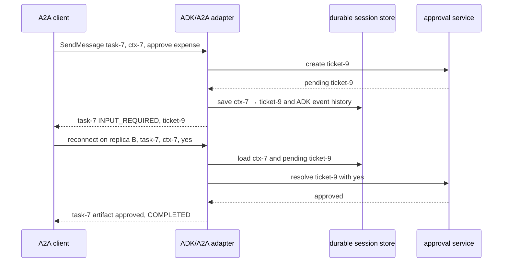

# A2A with the Google Agent Development Kit (ADK)

> **Who this is for**: Engineers using or evaluating Google ADK who want to expose ADK agents over A2A and consume remote A2A agents. Before reading this, understand how an A2A server is structured: **[Building a Server](../03_python/02_building_a_server.md)**.

ADK (`google-adk`) offers a concise native A2A path: `to_a2a()` exposes an agent and `RemoteA2aAgent` consumes a peer without a handwritten SDK adapter. This is a claim about those two APIs' ergonomics, not a ranking of protocol coverage across frameworks.

The [ADK A2A exposing guide](https://adk.dev/a2a/quickstart-exposing/) labels its Python integration **experimental** and says it detects both `a2a-sdk` 0.3.x and 1.x; these notes target the 1.x shape (checked 2026-10-12). Resolve and lock a compatible pair before using the code below.

---

## 1. ADK orientation in 60 seconds

ADK is Google's Python framework for building LLM agents. The pieces you need before touching A2A:

```python
from google.adk.agents import Agent          # alias of LlmAgent
from google.adk.runners import Runner
from google.adk.sessions import InMemorySessionService
from google.genai import types

def check_prime(number: int) -> dict:
    """Return whether `number` is prime."""
    if number < 2:
        return {"number": number, "is_prime": False}
    for d in range(2, int(number ** 0.5) + 1):
        if number % d == 0:
            return {"number": number, "is_prime": False}
    return {"number": number, "is_prime": True}

# An Agent = model + instruction + tools. `Agent` is a re-export of `LlmAgent`.
root_agent = Agent(
    model="gemini-flash-latest",
    name="prime_agent",
    description="Checks whether numbers are prime.",
    instruction="Use the check_prime tool to answer prime-number questions.",
    tools=[check_prime],
)
```

Running it locally goes through a `Runner`, which streams `Event` objects — the fundamental unit of ADK execution:

```python
runner = Runner(
    agent=root_agent,
    app_name="prime_app",
    session_service=InMemorySessionService(),
)

async def ask(user_id: str, session_id: str, text: str):
    message = types.Content(role="user", parts=[types.Part(text=text)])
    async for event in runner.run_async(
        user_id=user_id, session_id=session_id, new_message=message
    ):
        # Events carry partial text, tool calls, tool results, state deltas, errors.
        if event.is_final_response():
            print(event.content.parts[0].text)
```

> **Key insight**: An ADK `Event` is a superset of a chat message — it can be a partial token, a `function_call`, a `function_response`, a `state_delta`, or an error. A2A's job is to project that stream onto the protocol's `Message` / `Task` / `TaskStatusUpdateEvent` types. ADK does that projection for you.

| ADK concept | Role | A2A counterpart |
|-------------|------|-----------------|
| `Agent` / `LlmAgent` | The agent definition | The thing behind an agent card |
| Tool (plain function, `FunctionTool`) | Capability | Surfaces as a skill in the card |
| `Runner` | Drives one invocation, yields `Event`s | Server-side execution loop |
| Session (`SessionService`) | Conversation state + event history | A2A `contextId` |
| `Event` | One step of execution | `Message` / `Task` / status update |

---

## 2. Exposing an ADK agent with `to_a2a()`

The fast path. `to_a2a()` wraps an existing ADK agent and returns a Starlette/uvicorn-compatible **ASGI app** that speaks A2A — no `AgentExecutor` boilerplate.

```python
# agent.py
from google.adk.agents import Agent
from google.adk.a2a.utils.agent_to_a2a import to_a2a

def check_prime(number: int) -> dict:
    """Return whether `number` is prime."""
    if number < 2:
        return {"number": number, "is_prime": False}
    for divisor in range(2, int(number ** 0.5) + 1):
        if number % divisor == 0:
            return {"number": number, "is_prime": False}
    return {"number": number, "is_prime": True}

root_agent = Agent(
    model="gemini-flash-latest",
    name="check_prime_agent",
    description="Checks whether numbers are prime.",
    instruction="Use the check_prime tool to answer prime-number questions.",
    tools=[check_prime],
)

# Returns an ASGI app. The agent card is auto-generated in-memory at startup.
a2a_app = to_a2a(root_agent, port=8001)
```

Serve it with uvicorn — point at the `module:attribute` holding the app:

```bash
uvicorn agent:a2a_app --host localhost --port 8001
```

ADK introspects the agent (name, description, tools) and publishes a card at the well-known path:

```
http://localhost:8001/.well-known/agent-card.json
```

The auto-generated v1.0 card includes `supportedInterfaces`, `capabilities`, `skills`, `defaultInputModes`/`defaultOutputModes` (`text/plain`), and `version`.

This file is complete at the Python name/import level. Serving it still requires a compatible ADK installation and Gemini credentials; the model's answer wording is nondeterministic. Fetch the card first, then send a prime question and inspect the Task state and result against your installed ADK version. The local [adapter contract fixture](../examples/frameworks/adapter_contract.py) checks only the deterministic event-to-Task boundary, not `to_a2a()` or model behavior.

⚠️ The `port` argument to `to_a2a()` only sets the endpoint URL advertised in the generated card's first `supportedInterfaces` entry. It does *not* bind a socket — uvicorn does that. If `to_a2a(..., port=8001)` disagrees with `uvicorn --port 9000`, the card advertises a URL clients cannot reach.

> **Rule**: Keep the `port` passed to `to_a2a()` identical to the port uvicorn binds, and make the advertised `supportedInterfaces[*].url` reachable from where clients actually run (not `localhost` if they are remote).

---

## 3. Exposing with an explicit agent card

`to_a2a()` accepts an `AgentCard` object or a path to a JSON file when you need control over skills, auth, or input/output modes:

```python
from a2a.types import AgentCard, AgentCapabilities, AgentInterface, AgentSkill
from google.adk.a2a.utils.agent_to_a2a import to_a2a

my_card = AgentCard(
    name="check_prime_agent",
    description="Checks whether integers are prime.",
    version="1.2.0",
    capabilities=AgentCapabilities(streaming=True),
    supported_interfaces=[
        AgentInterface(
            protocol_binding="JSONRPC",
            protocol_version="1.0",
            url="https://prime.internal.example.com",  # address clients will dial
        )
    ],
    default_input_modes=["text/plain"],
    default_output_modes=["text/plain"],
    skills=[
        AgentSkill(
            id="check_prime",
            name="Check prime",
            description="Determine whether a number is prime.",
            tags=["math"],
            examples=["Is 7919 prime?"],
        ),
    ],
)

a2a_app = to_a2a(root_agent, port=8001, agent_card=my_card)
# Or load from disk: to_a2a(root_agent, port=8001, agent_card="/path/agent-card.json")
```

### The `adk api_server --a2a` route

For hosting **multiple agents from one parent folder**, use the ADK CLI instead of hand-writing uvicorn entrypoints. Each agent folder must contain its own `agent.json` card:

```bash
adk api_server --a2a --port 8001 ./agents_root
# add --log_level debug while wiring things up
```

This serves every sub-agent folder under `./agents_root`, exposing each at `/.well-known/agent-card.json` relative to its mount path (e.g. `/a2a/check_prime_agent/.well-known/agent-card.json`).

### The fully explicit route: `A2aAgentExecutor`

`to_a2a()` is itself a thin wrapper over the A2A SDK's request handler plus ADK's `A2aAgentExecutor`. Drop to it when you need converter or interceptor hooks:

```python
from google.adk.a2a.executor.a2a_agent_executor import A2aAgentExecutor

executor = A2aAgentExecutor(
    runner=runner,            # your configured ADK Runner
    # custom hooks: a2a_part_converter, gen_ai_part_converter, request_converter
)
```

You then hand `executor` to the standard `a2a-sdk` `DefaultRequestHandler` and mount the `create_jsonrpc_routes` / `create_agent_card_routes` factories on a Starlette app — exactly the server shape from [Building a Server](../03_python/02_building_a_server.md). ✅ Use the explicit route only when you genuinely need a custom converter; otherwise `to_a2a()` is less to maintain.

---

## 4. Consuming a remote A2A agent with `RemoteA2aAgent`

`RemoteA2aAgent` is an ADK `Agent` subclass that, instead of calling a model, forwards the turn to a remote A2A server. It is a **drop-in sub-agent**.

```python
from google.adk.agents.remote_a2a_agent import (
    RemoteA2aAgent,
    AGENT_CARD_WELL_KNOWN_PATH,   # = "/.well-known/agent-card.json"
)

prime_agent = RemoteA2aAgent(
    name="prime_agent",
    description="Agent that checks whether numbers are prime.",
    agent_card=(
        f"http://localhost:8001/a2a/check_prime_agent{AGENT_CARD_WELL_KNOWN_PATH}"
    ),
    use_legacy=False,   # opt into the current ADK<->A2A integration
)
```

| Parameter | Purpose |
|-----------|---------|
| `name` | Local identifier; the LLM uses it to decide delegation |
| `description` | Fed to the parent agent's router — make it precise |
| `agent_card` | URL of the remote card (or a card object / dict) |
| `use_legacy` | `False` for the current integration; `True` is the old path |
| `config` | Optional `A2aRemoteAgentConfig` for converters/interceptors |

⚠️ `description` is not cosmetic. The **parent** agent's LLM routes to sub-agents using their descriptions. A vague description ("does math stuff") causes mis-delegation. Be specific about inputs and outputs.

> **Rule**: The `agent_card` URL must resolve to a live card *at construction-or-first-call time*. ADK fetches it lazily; a 404 there surfaces as a runtime failure deep inside an invocation, not at import.

### Auth and request shaping with `A2aRemoteAgentConfig`

```python
import os

from fastapi.openapi.models import HTTPBearer
from google.adk.auth.auth_credential import (
    AuthCredential,
    AuthCredentialTypes,
    HttpAuth,
    HttpCredentials,
)
from google.adk.a2a.agent.config import A2aRemoteAgentConfig

bearer_scheme = HTTPBearer(scheme="bearer")
bearer_credential = AuthCredential(
    auth_type=AuthCredentialTypes.HTTP,
    http=HttpAuth(
        scheme="bearer",
        credentials=HttpCredentials(token=os.environ["PRIME_TOKEN"]),
    ),
)

prime_agent = RemoteA2aAgent(
    name="prime_agent",
    description="Agent that checks whether numbers are prime.",
    agent_card=f"http://localhost:8001/a2a/check_prime_agent{AGENT_CARD_WELL_KNOWN_PATH}",
    use_legacy=False,
    auth_scheme=bearer_scheme,
    auth_credential=bearer_credential,
    config=A2aRemoteAgentConfig(),
)
```

`RemoteA2aAgent` turns this credential into current card and request interceptors, so both card resolution and Message sends carry `Authorization: Bearer <redacted>`. A successful delegated turn reaches `TASK_STATE_COMPLETED`; `401` on either request means the credential or advertised scheme is wrong.

❌ Do not substitute an object with `before_request(request)` that mutates `request.headers`. The current request hook receives `(InvocationContext, A2AMessage, ParametersConfig)` and returns `(message_or_event, parameters)`; it is not HTTP middleware. Prefer the supported `auth_scheme`/`auth_credential` path above.

---

## 5. Multi-agent example: root delegates to a remote agent

A local root agent with two children — one local (`roll_agent`), one remote (`prime_agent`). The root's LLM picks which to invoke.

```python
# root/agent.py
import os
from google.adk.agents import Agent
from google.adk.agents.remote_a2a_agent import (
    RemoteA2aAgent,
    AGENT_CARD_WELL_KNOWN_PATH,
)

def roll_die(sides: int) -> int:
    """Roll a die with `sides` faces."""
    import random
    return random.randint(1, sides)

roll_agent = Agent(
    model="gemini-flash-latest",
    name="roll_agent",
    description="Rolls dice with a configurable number of sides.",
    instruction="Use roll_die to satisfy dice-rolling requests.",
    tools=[roll_die],
)

# Remote agent exposed in section 2/3, consumed here as a sub-agent.
prime_agent = RemoteA2aAgent(
    name="prime_agent",
    description="Checks whether a given integer is prime.",
    agent_card=f"http://localhost:8001/a2a/check_prime_agent{AGENT_CARD_WELL_KNOWN_PATH}",
    use_legacy=False,
)

root_agent = Agent(
    model="gemini-flash-latest",
    name="root_agent",
    instruction=(
        "You coordinate two specialists. Delegate dice rolls to roll_agent "
        "and prime-number checks to prime_agent. Do not answer those yourself."
    ),
    sub_agents=[roll_agent, prime_agent],   # RemoteA2aAgent sits alongside local agents
)
```

Run the consuming side with the ADK dev UI (point it at the folder containing `root/`):

```bash
# 1. Start the remote agent
adk api_server --a2a --port 8001 ./agents_root

# 2. Start the root agent that delegates to it
adk web ./
```

Flow when a user asks *"Is 7919 prime?"*:

```
user ──> root_agent (LLM router)
              │  picks prime_agent based on its description
              ▼
        RemoteA2aAgent "prime_agent"
              │  A2A SendMessage over HTTP
              ▼
   remote A2A server (to_a2a-wrapped check_prime_agent)
              │  runs ADK Runner, executes check_prime tool
              ▼
        A2A Task (TASK_STATE_COMPLETED) ──> events ──> root_agent ──> user
```

The root agent never knows `prime_agent` lives on another process. ✅ This is the payoff of native integration: a remote agent and a local agent are both just entries in `sub_agents`.

---

## 6. Mapping ADK `Event`s and long-running tools onto A2A `Task`s

This is the part that makes the abstraction leak-proof — and the part to understand before debugging.

**Server side (`to_a2a` / `A2aAgentExecutor`)** consumes the `Runner.run_async()` event stream and converts:

| ADK `Event` | A2A projection |
|-------------|----------------|
| Partial text event | `Message`/artifact chunks streamed via `SendStreamingMessage` |
| `function_call` / `function_response` | Internal to the Task; not separate A2A messages |
| Final response event | `Task` transitions to `TASK_STATE_COMPLETED`, text in artifact/message |
| Error event | `Task` transitions to `TASK_STATE_FAILED` with an error |
| Long-running tool pending | `Task` transitions to `TASK_STATE_INPUT_REQUIRED` |

**Client side (`RemoteA2aAgent`)** does the inverse: incoming A2A `Message` / `Task` / `TaskStatusUpdateEvent` / `TaskArtifactUpdateEvent` are converted back into ADK `Event`s and yielded into the parent agent's stream (this is what the `*_converter` config hooks override).

### Long-running tools and `input-required`

When an application needs approval, it must persist the pending ticket, expose a pause through its chosen ADK/A2A adapter, and later match the answer to that ticket. The following is an **application design excerpt**, not a standalone ADK program: `create_approval_ticket` and the completion callback belong to your approval service. Check the installed converter's event mapping before claiming that a particular `LongRunningFunctionTool` return automatically becomes A2A `input-required`.

```python
from google.adk.tools import LongRunningFunctionTool

def request_approval(amount: float) -> dict:
    """Kick off an out-of-band approval. Returns a ticket; resolves later."""
    ticket = create_approval_ticket(amount)
    # Application code must persist this ticket and arrange the later response.
    return {"status": "pending", "ticket_id": ticket.id}

approval_tool = LongRunningFunctionTool(func=request_approval)
```

The contract below follows `task-7` after ticket `ticket-9` is created. It is the behavior the adapter and application must prove together, rather than a guarantee of the excerpt above.



The first request creates the ticket, saves enough ADK session history to identify the pending tool call, and emits `INPUT_REQUIRED`; it has produced no final artifact yet. The second request must carry the existing Task and context IDs. Replica B reads the saved session and ticket before injecting the follow-up tool response, then publishes one artifact and `COMPLETED`. A new `contextId` addresses a different session; it cannot safely attach the answer to `ticket-9`. An in-memory session service cannot support this cross-replica trace. Run `python3 examples/frameworks/adapter_contract.py` from the repository root to see the deterministic projection and rejected changed-ID branch. That fixture does not verify ADK's converter or a live A2A endpoint.

⚠️ If the follow-up arrives under a new context, the adapter may open a new session and lose the pending call. Persist the session and ticket together; require the same Task and context IDs on continuation and verify the exact mapping in your ADK release.

---

## 7. Failure modes and gotchas

| Symptom | Likely cause | Fix |
|---------|--------------|-----|
| `RemoteA2aAgent` fails mid-invocation, not at import | Card fetched lazily; URL 404s | Curl `…/.well-known/agent-card.json` before wiring it in |
| Client dials `localhost` but agent is remote | `to_a2a(port=…)` / card `url` set to `localhost` | Set the card `url` to a routable host (sec. 2–3) |
| `404` for the card | `agent.json` missing in an `adk api_server --a2a` folder | Add an `agent.json` per agent folder |
| Card path mismatch | Mixing `/agent.json` and `/agent-card.json` | Use the `AGENT_CARD_WELL_KNOWN_PATH` constant, don't hardcode |
| `401` / `403` from the remote agent | No credential attached | Add a `request_interceptors` hook in `A2aRemoteAgentConfig` (sec. 4) |
| `ImportError` on `google.adk.a2a.*` or `a2a.types` | Version skew: `google-adk` vs `a2a-sdk` | Pin both; install `google-adk[a2a]` extra |
| Deserialization / converter errors | A2A protocol version skew between server and client | Match `supportedInterfaces[*].protocolVersion`; upgrade the lagging side |
| Remote turn ends in `failed` unexpectedly | The application expected a pause but the installed adapter reported an error | Inspect the ADK event and converter output; verify whether this release supports the intended pause mapping before promising continuation |

### Version skew — the most common production break

`to_a2a`, `RemoteA2aAgent`, and the converter classes live in `google.adk.a2a.*` but depend on the separately-versioned `a2a-sdk` (`a2a.types`, request handlers). ADK releases sometimes require a newer `a2a-sdk` than the one already installed.

```bash
# Install the A2A extra so the matching a2a-sdk version is resolved together.
pip install "google-adk[a2a]"
```

> **Rule**: Pin `google-adk` and `a2a-sdk` together in your lockfile, and upgrade them as a pair. A mismatched pair fails as `ImportError` at best and silent converter misbehavior at worst.

❌ Don't `pip install google-adk a2a-sdk` with unpinned versions across server and client repos — independent upgrades drift the protocol version and break the wire format.

✅ Verify the contract end-to-end after any upgrade: fetch the card, send one `SendMessage`, and confirm a clean `TASK_STATE_COMPLETED` task before trusting the multi-agent tree.

---


## Recap and practice

- `to_a2a()` creates the server app and card; the ASGI server's listener must agree with the card URL.
- `RemoteA2aAgent` discovers a peer from its card and converts the remote result into ADK events for its parent.
- A pending approval needs a persisted ticket, ADK session, and A2A Task; the follow-up must find the same identities.
- A model response or a `LongRunningFunctionTool` return alone does not prove the A2A pause mapping. Observe the Task and follow-up result in the installed release.

**Q: `to_a2a(port=8001)` is served by uvicorn on port 9000. Why can card discovery succeed while a send fails?**

<details><summary>Answer</summary>

The listener serves the card at 9000, but the generated card advertises 8001. A client that follows the card calls the wrong endpoint. Set both ports and the routable host consistently.

</details>

**Q: A second replica receives approval for `ticket-9` under a new `contextId`. Should it create a new ADK session?**

<details><summary>Answer</summary>

No. The new session cannot identify the pending tool call. Reject the mismatched continuation and have the caller use the original Task and context IDs; the replica must load the persisted ticket and ADK event history.

</details>

**Try it:** Adapt the `task-7` trace for a rejected approval. Keep the saved IDs and decide the final Task state and artifact policy. Hint: rejection is a valid business result, but the Task must still terminate.

<details><summary>Worked solution</summary>

Load `ctx-7` and `ticket-9`, record the rejection in the approval service, and resume the pending ADK call with a rejected result. Emit a safe rejection artifact and `TASK_STATE_COMPLETED` if the agent successfully handled that business answer; use `TASK_STATE_FAILED` only if execution itself failed. Record one final state and do not leave the Task in `INPUT_REQUIRED`.

</details>

**Next**: [Part 3: CrewAI & Others](03_crewai_and_others.md)
