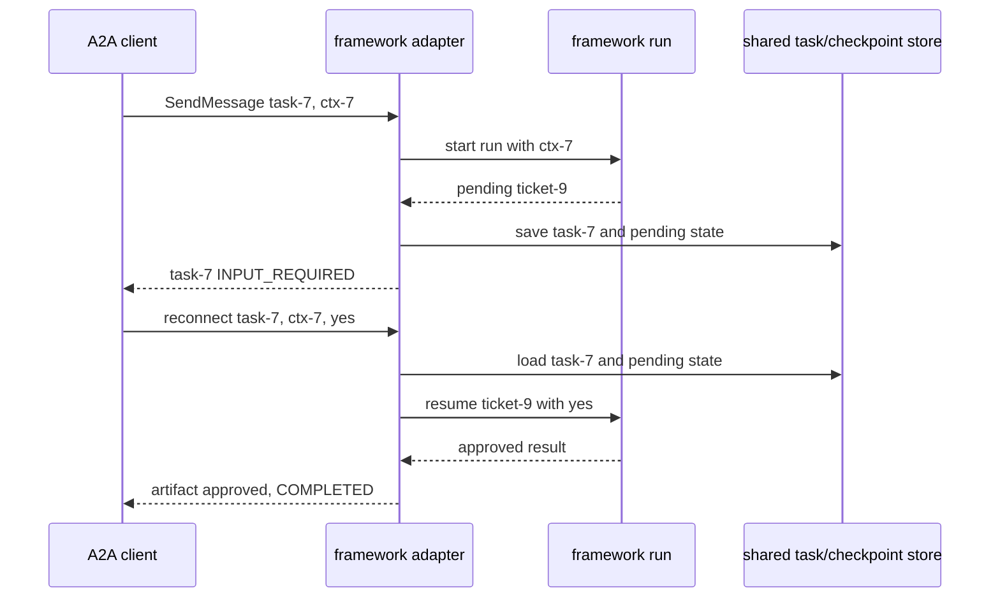

# CrewAI, Semantic Kernel, LlamaIndex & AG2 — A2A Integration Patterns

> **Who this is for**: Engineers building agents with CrewAI, Microsoft Semantic Kernel / Agent Framework, LlamaIndex, or AG2/AutoGen who want to expose them over A2A or consume remote A2A agents. Before reading this, understand the A2A server lifecycle: **[Building a Server](../03_python/02_building_a_server.md)**.

This file covers the *rest* of the agent-framework ecosystem. The mechanics of `AgentExecutor`, `RequestContext`, and `EventQueue` are assumed — see the prerequisite. Here we focus on what each framework gives you for free, what you still write by hand, and the integration state checked in **August 2026**.

> **Rule**: A2A is the wire protocol; the framework is an implementation detail behind it. Any framework agent can be A2A-exposed because A2A only cares about `Message` in and `Task`/artifacts out.

### Choose a branch before you read the implementations

| If your application already uses… | Start here | Integration boundary |
|---|---|---|
| CrewAI | [§2](#2-crewai) | Native single-agent configuration, or an explicit executor for a whole Crew |
| Semantic Kernel | [§3](#3-semantic-kernel--microsoft-agent-framework) | Explicit executor; do not invent an SK-native A2A class |
| Microsoft Agent Framework | [§3](#3-semantic-kernel--microsoft-agent-framework) | Current Python `A2AAgent` consumption and hosting samples |
| LlamaIndex | [§4](#4-llamaindex) | Explicit executor around a Workflow |
| AG2 | [§5](#5-ag2--autogen) | Native `A2AServer` and `A2AConfig` |

If you have not selected a framework, compare operational needs first: explicit control favors the SDK adapter; native integration favors less glue but couples you to the framework's release cadence. Stop after your chosen branch and [the shared gotchas](#6-shared-gotchas).

**Decision exercise:** Your existing Crew coordinates three agents and must return a binary image artifact. Which branch owns the A2A boundary? The explicit Crew executor does: it can run the whole Crew and construct the binary artifact. The native single-Agent config attaches to one Agent, so it does not by itself express that result mapping.

### Integration state (checked August 2026)

| Framework | Server support | Client support |
|---|---|---|
| CrewAI | Native single-agent config; explicit executor for multi-agent Crews | Native config or an SDK-backed tool |
| Semantic Kernel | Explicit executor | Explicit plugin/function wrapper |
| Microsoft Agent Framework | Current Python hosting samples | Python `agent_framework.a2a.A2AAgent` |
| LlamaIndex | Explicit executor around a Workflow | SDK-backed `FunctionTool` |
| AG2 | Native `ag2.a2a.A2AServer` | Regular `Agent` with `ag2.a2a.A2AConfig` |

"Native" does not mean frozen. Pin and test the framework together with its supported `a2a-sdk`; do not copy class names from old blog posts.

---

## 1. The general adapter pattern

Every "framework → A2A" integration is the same shape. You write (or the framework gives you) an `AgentExecutor` that sits between the A2A transport and the framework's native agent loop. It does three things on the **server** side, and the mirror image on the **client** side.

```
                          A2A SERVER SIDE (expose a framework agent)
        ┌────────────────────────────────────────────────────────────────────┐
        │                                                                    │
  A2A   │   ┌──────────────┐   (1) translate    ┌───────────────────────┐    │
 Client ├──▶│ A2A transport │──── inbound ──────▶│  AgentExecutor.execute │   │
  Msg   │   │ (Starlette /  │   A2A Message      │                        │   │
        │   │  DefaultReq-  │   → framework      │  (2) run framework     │   │
        │   │  Handler)     │     input type     │      agent / crew /    │   │
        │   │               │                    │      workflow          │   │
        │   │               │◀─── A2A Task ──────│                        │   │
        │   │               │   events /         │  (3) emit result as    │   │
        │   │               │   artifacts        │      Task events via   │   │
        │   └──────────────┘   via EventQueue    │      event_queue       │   │
        │                                        └───────────┬───────────┘   │
        │                                                    │               │
        │                                          ┌─────────▼──────────┐    │
        │                                          │  Framework agent   │    │
        │                                          │  (Crew / SK agent /│    │
        │                                          │   Workflow / AG2)  │    │
        │                                          └────────────────────┘    │
        └────────────────────────────────────────────────────────────────────┘

                          A2A CLIENT SIDE (consume a remote A2A agent)
        ┌────────────────────────────────────────────────────────────────────┐
        │   Framework's native "tool" / "agent" abstraction                  │
        │   wraps an a2a-sdk ClientFactory + send_message call.              │
        │   The remote agent looks local to the framework's orchestrator.    │
        └────────────────────────────────────────────────────────────────────┘
```

**Server side — three responsibilities of the executor:**

1. **Translate inbound.** Pull the user input out of `RequestContext` (`context.get_user_input()` for plain text, or walk `context.message.parts` for files/data) and shape it into whatever the framework expects — a `Crew` kickoff input dict, an SK `ChatMessageContent`, a LlamaIndex `StartEvent`, an AG2 chat message.
2. **Run the framework agent.** Call the framework's run/kickoff/invoke. This is usually where the sync-vs-async mismatch bites (see §6).
3. **Emit the result.** Wrap the output in A2A `Task` events and artifacts and push them through `event_queue` — usually via `TaskUpdater.add_artifact(...)` plus `TaskUpdater.complete()` for one-shot, or explicit `TaskStatusUpdateEvent` / `TaskArtifactUpdateEvent` for streaming.

**Client side** is the mirror: you wrap an `a2a-sdk` client call inside the framework's native extension point—a CrewAI tool, an SK plugin `kernel_function`, or a LlamaIndex `FunctionTool`—or use a native client such as an AG2 `Agent` configured with `A2AConfig`. The framework's planner then treats the remote agent as if it were local.

> **Key insight**: There is no magic. "Native A2A support" in a framework just means *they* wrote the adapter for you. Where they haven't, you write the ~60-line `AgentExecutor` from the prerequisite file.

---

## 2. CrewAI

CrewAI is the most common framework paired with A2A, and as of the **0.x → A2A-native** releases it ships first-class A2A support: you pass an `a2a` config object to a CrewAI `Agent` and it becomes A2A-aware in either direction. The classic [`a2a-samples` CrewAI example](https://github.com/a2aproject/a2a-samples/tree/main/samples/python/agents/crewai) (an image-generation `Crew`) predates that and still uses a **hand-written** `AgentExecutor` — useful to study because it shows exactly what the native config now automates.

### 2a. Exposing a Crew over A2A

The sample's pattern: wrap the `Crew` in an executor and run it as a standard A2A Starlette app.

```python
# agent_executor.py — hand-written executor (mirrors the a2a-samples CrewAI example)
from a2a.server.agent_execution import AgentExecutor, RequestContext
from a2a.server.events import EventQueue
from a2a.helpers import new_task_from_user_message
from a2a.server.tasks import TaskUpdater
from a2a.types import InvalidParamsError, Part, UnsupportedOperationError
from a2a.utils.errors import ServerError

from crewai import Agent, Crew, Task
from crewai.process import Process


class ResearchCrewExecutor(AgentExecutor):
    """Exposes a CrewAI Crew as a single A2A agent."""

    def __init__(self) -> None:
        researcher = Agent(
            role="Research Analyst",
            goal="Answer the user's question with sourced facts",
            backstory="Senior analyst, terse and precise.",
        )
        self._researcher = researcher

    async def execute(self, context: RequestContext, event_queue: EventQueue) -> None:
        # (1) translate inbound A2A Message → Crew kickoff input
        query = context.get_user_input()
        if not query:
            raise ServerError(error=InvalidParamsError())

        crew_task = Task(
            description=f"Research and answer: {query}",
            expected_output="A concise, sourced answer.",
            agent=self._researcher,
        )
        crew = Crew(
            agents=[self._researcher],
            tasks=[crew_task],
            process=Process.sequential,
        )

        # (2) run the framework agent. Crew.kickoff() is SYNCHRONOUS — see §6.
        #     kickoff_async() exists; use it to avoid blocking the event loop.
        result = await crew.kickoff_async(inputs={"query": query})

        # (3) emit result as an A2A Task with a text artifact
        a2a_task = context.current_task or new_task_from_user_message(context.message)
        await event_queue.enqueue_event(a2a_task)
        updater = TaskUpdater(event_queue, a2a_task.id, a2a_task.context_id)
        await updater.add_artifact(
            [Part(text=str(result))],
            name=f"research_{a2a_task.id}",
        )
        await updater.complete()

    async def cancel(self, context: RequestContext, event_queue: EventQueue) -> None:
        raise ServerError(error=UnsupportedOperationError())
```

Wire it into a server exactly as in the prerequisite (`DefaultRequestHandler` + the `create_jsonrpc_routes` / `create_agent_card_routes` factories on a Starlette app); the only CrewAI-specific part is the executor body.

This block is an **executor excerpt**: it needs a CrewAI installation, a configured model, and the prerequisite's complete server wiring. Its intended first result is one Task, an artifact named `research_<task id>` containing the Crew answer, then `TASK_STATE_COMPLETED`. A card fetch checks exposure only; it does not prove that `kickoff_async()` ran or that the result reached an artifact. Run the prerequisite's `SendMessage` request against the assembled app and inspect both fields before calling it verified.

✅ The native shortcut: instead of the executor above, recent CrewAI lets you pass `A2AServerConfig` directly to an `Agent` (`Agent(..., a2a=A2AServerConfig(name="Research Analyst", protocol_version="1.0"))`) and CrewAI builds the A2A surface for you. Use the hand-written executor when you need a *multi-agent Crew* exposed as one A2A endpoint, since the native config attaches to a single `Agent`.

⚠️ CrewAI's native A2A surface is current, but its server config still exposes compatibility-oriented field names such as `preferred_transport`, `additional_interfaces`, and a documented `protocol_version` default of `"0.3"`. For A2A v1.0 teaching material, set the version explicitly and fetch the generated card before publishing examples.

### 2b. Using a remote A2A agent as a CrewAI tool

Two routes. The **native** route — pass `A2AClientConfig` to a CrewAI `Agent` so the remote agent becomes delegable:

```python
import os

from crewai import Agent
from crewai.a2a import A2AClientConfig          # native A2A client config
from crewai.a2a.auth import BearerTokenAuth     # also: APIKeyAuth, OAuth2ClientCredentials

planner = Agent(
    role="Trip Planner",
    goal="Plan a trip, delegating currency questions to the remote FX agent",
    backstory="Coordinates specialist agents.",
    a2a=A2AClientConfig(
        # points at the remote agent's discovery document
        endpoint="https://fx-agent.internal/.well-known/agent-card.json",
        auth=BearerTokenAuth(token=os.environ["FX_AGENT_TOKEN"]),
    ),
)
```

The **manual** route — wrap an `a2a-sdk` call in a `@tool`, useful when you want fine control or are on an older CrewAI:

```python
from crewai.tools import tool
import httpx
from uuid import uuid4

from a2a.client import A2ACardResolver, ClientConfig, ClientFactory
from a2a.helpers import get_stream_response_text
from a2a.types import Message, Part, Role, SendMessageRequest

@tool("RemoteFXAgent")
async def remote_fx_agent(question: str) -> str:
    """Ask the remote currency-exchange A2A agent a question."""
    async with httpx.AsyncClient() as http:
        resolver = A2ACardResolver(
            httpx_client=http,
            base_url="https://fx-agent.internal",
        )
        card = await resolver.get_agent_card()
        factory = ClientFactory(ClientConfig(httpx_client=http))
        client = factory.create(card)
        request = SendMessageRequest(
            message=Message(
                role=Role.ROLE_USER,
                parts=[Part(text=question)],
                message_id=str(uuid4()),
            )
        )
        chunks = []
        async for event in client.send_message(request):
            text = get_stream_response_text(event, delimiter="")
            if text:
                chunks.append(text)
        return "".join(chunks).strip()
```

> **Rule**: `crewai.a2a.config.A2AConfig` is **deprecated** (removed in CrewAI v2.0.0). Use the split `A2AClientConfig` / `A2AServerConfig` classes. On the client side, the discovery URL parameter is `endpoint`, not `url`.

⚠️ Confirm class names against *your* installed CrewAI version. The `crewai.a2a` namespace is new and has moved fast through the 1.x line.

---

## 3. Semantic Kernel / Microsoft Agent Framework

Two distinct things share the "Microsoft" label here — keep them separate:

- **Semantic Kernel (SK)** — the older orchestration SDK. In the integration surface checked in August 2026, SK has **no built-in `A2AAgent` class**. The Microsoft integration pattern and [`a2a-samples` semantickernel example](https://github.com/a2aproject/a2a-samples/tree/main/samples/python/agents/semantickernel) wire A2A by hand around a `ChatCompletionAgent`. Do not confuse this with Microsoft Agent Framework's separate `agent_framework.a2a.A2AAgent`.
- **Microsoft Agent Framework (MAF)** — the current Python package exposes `agent_framework.a2a.A2AAgent` for non-streaming, streaming, polling, reconnect, and binding selection, and ships separate Python hosting samples. Treat MAF as the Microsoft-native path for A2A, but do not assume the older `semantic_kernel` package has the same abstraction.

### Exposing a SK agent over A2A (the sample pattern)

The sample wraps a SK `ChatCompletionAgent` and maps SK streaming onto A2A status updates. The following is an **explanatory excerpt, not a runnable program**: `_status_update` and the final artifact/terminal event are intentionally delegated to the complete executor in [Building a Server](../03_python/02_building_a_server.md).

```python
from a2a.server.agent_execution import AgentExecutor, RequestContext
from a2a.server.events import EventQueue
from semantic_kernel.agents import ChatCompletionAgent, ChatHistoryAgentThread
from semantic_kernel.connectors.ai.open_ai import OpenAIChatCompletion

class SemanticKernelExecutor(AgentExecutor):
    def __init__(self) -> None:
        self._agent = ChatCompletionAgent(
            service=OpenAIChatCompletion(),
            name="TravelManager",
            instructions="Plan trips. Ask for clarification when budget is missing.",
        )

    async def execute(self, context: RequestContext, event_queue: EventQueue) -> None:
        thread = ChatHistoryAgentThread()      # SK conversational memory
        # SK is async-native: invoke_stream yields StreamingChatMessageContent.
        async for response in self._agent.invoke_stream(
            messages=context.get_user_input(), thread=thread
        ):
            # map each SK streaming chunk → an A2A TaskStatusUpdateEvent
            await event_queue.enqueue_event(_status_update(context, str(response)))
        # ... emit a final artifact and TASK_STATE_COMPLETED status (omitted)
```

✅ SK is **async-native** (`invoke`, `invoke_stream` are coroutines), so it drops cleanly into `AgentExecutor.execute` with no thread-pool wrapping.

For consuming a remote A2A agent from SK, the sample/devblog approach builds a `KernelFunction` from the remote Agent Card and bundles it as a plugin — there is no shipped helper class; you write the factory yourself.

---

## 4. LlamaIndex

LlamaIndex exposes agents and **Workflows** over A2A via a hand-written executor. The reference is the [`a2a-samples` LlamaIndex example](https://github.com/a2aproject/a2a-samples/tree/main/samples/python/agents/llama_index_file_chat) — a file-chat **Workflow** (`ParseAndChat`) with multi-turn memory, file parsing, streaming, and JWK-authenticated push notifications. There is no official `a2a` package from LlamaIndex; the integration lives as a sample, so treat it as a pattern, not a library.

### Exposing a LlamaIndex Workflow over A2A

The pattern: feed the inbound A2A message in as a Workflow `StartEvent`, and translate each emitted Workflow event into an A2A event. The following is an **explanatory excerpt, not a runnable program**: `_status_update` and `_completed` stand for the concrete `TaskUpdater` calls shown in [Building a Server](../03_python/02_building_a_server.md).

```python
from a2a.server.agent_execution import AgentExecutor, RequestContext
from a2a.server.events import EventQueue
from llama_index.core.workflow import Workflow

class LlamaIndexWorkflowExecutor(AgentExecutor):
    def __init__(self, workflow: Workflow) -> None:
        self._workflow = workflow

    async def execute(self, context: RequestContext, event_queue: EventQueue) -> None:
        # (1) inbound A2A Message → Workflow input
        handler = self._workflow.run(msg=context.get_user_input())

        # (2)+(3) stream Workflow events → A2A status updates
        async for event in handler.stream_events():
            # the sample emits a LogEvent per step; map it to a TaskStatusUpdateEvent
            await event_queue.enqueue_event(_status_update(context, str(event)))

        result = await handler                # final Workflow result
        await event_queue.enqueue_event(_completed(context, result))
```

LlamaIndex `Workflow` event streaming maps almost 1:1 onto A2A's incremental `Task` events — each `LogEvent`/custom event becomes a `TaskStatusUpdateEvent`, and the final result becomes an artifact. To consume a remote A2A agent inside LlamaIndex, wrap the `a2a-sdk` client call in a `FunctionTool` and hand it to an `AgentWorkflow` / `FunctionAgent`.

For both this branch and the Semantic Kernel excerpt, the omitted `_status_update`/`_completed` functions are real adapter work, not built-in functions. Use `TaskUpdater` from the prerequisite and test a working update followed by exactly one artifact and a final state. The local [adapter contract fixture](../examples/frameworks/adapter_contract.py) exercises that expected state sequence without loading either framework; it does not establish their API compatibility.

⚠️ Workflows are async-native, but `Workflow.run()` returns a *handler* — you must `await` it (or stream it) inside `execute`; forgetting to await silently drops the result.

---

## 5. AG2 / AutoGen

AG2 (formerly AutoGen; PyPI package and import name `ag2`) provides native server and client adapters:

- **`A2AServer`** wraps a regular `Agent`; `build_jsonrpc(...)` returns an ASGI application.
- **`A2AConfig`** is a model configuration for a regular `Agent`; the remote A2A endpoint becomes that agent's model provider.

Both sides are first-class; you rarely write a raw `AgentExecutor` for AG2. The current APIs below replace older examples that used `autogen.a2a.A2aAgentServer` or `A2aRemoteAgent`.

### Expose an AG2 agent over A2A

```python
import asyncio
import os

import uvicorn
from ag2 import Agent
from ag2.a2a import A2AServer, build_card
from ag2.config import OpenAIConfig


async def main() -> None:
    reviewer = Agent(
        name="reviewer",
        system_message="Review Python code for correctness and typing.",
        config=OpenAIConfig(
            model="gpt-4.1-mini",
            api_key=os.environ["OPENAI_API_KEY"],
        ),
    )
    server = A2AServer(reviewer)
    card = build_card(reviewer, url="http://127.0.0.1:8000")
    app = server.build_jsonrpc(url="http://127.0.0.1:8000", card=card)
    await uvicorn.Server(uvicorn.Config(app, host="127.0.0.1", port=8000)).serve()


asyncio.run(main())
```

### Consume a remote A2A agent in AG2

```python
import asyncio

from ag2 import Agent
from ag2.a2a import A2AConfig


async def main() -> None:
    reviewer = Agent(
        "remote-reviewer",
        config=A2AConfig(card_url="http://127.0.0.1:8000"),
    )
    reply = await reviewer.ask("Review this function: def add(a, b): return a + b")
    print(reply.response.content)


asyncio.run(main())
```

AG2 demonstrates the agent-as-a-service pattern: the remote agent's tools, environment, and model remain encapsulated behind the A2A endpoint.

---

## 6. Shared gotchas

### Gotchas

⚠️ **Framework version skew with `a2a-sdk`.** Each sample pins a specific `a2a-sdk` version in `pyproject.toml`. Native integrations such as `ag2.a2a` and `crewai.a2a` depend on a supported range—bumping `a2a-sdk` independently can break client/executor signatures. Pin both together and upgrade them as a pair.

⚠️ **Sync vs async mismatch.** `AgentExecutor.execute` is a coroutine on a shared event loop. CrewAI's `Crew.kickoff()` is **synchronous and blocking** — calling it directly stalls every concurrent A2A request. Use `Crew.kickoff_async()`, or offload with `await asyncio.to_thread(crew.kickoff, ...)`. SK and LlamaIndex Workflows are async-native. AG2's current examples likewise use async `Agent.ask(...)`.

⚠️ **Mapping framework streaming onto A2A events.** Frameworks emit their own event types — LlamaIndex `Workflow` events, SK `StreamingChatMessageContent`, CrewAI step callbacks, AG2 messages. A2A expects `TaskStatusUpdateEvent` (progress) and `TaskArtifactUpdateEvent` (incremental output), terminated by `TASK_STATE_COMPLETED` or `TASK_STATE_FAILED`. You must translate each. ❌ Do not forward raw framework chunks as text and forget the terminal event — the A2A client will hang waiting for a final state. ✅ Always emit exactly one terminal status, and set `AgentCapabilities(streaming=...)` on the Agent Card to match what your executor actually does (the CrewAI image sample sets `streaming=False` precisely because it returns one artifact).

💡 **When in doubt, hand-write the executor.** Native configs attach to a single agent and assume a simple request/response. For multi-agent Crews, branching Workflows, or custom artifact types, the explicit `AgentExecutor` from [Building a Server](../03_python/02_building_a_server.md) is more predictable than fighting a framework's abstraction.

---


## Apply the boundary to a changed request

All four branches must make the same A2A promise: a discoverable card, a `SendMessage` that yields either a Message or Task, and a result that agrees with the card's declared modes and capabilities. The framework's internal events are not A2A events until a native or explicit adapter projects them. A long-running branch adds a second promise: save the framework's pending state and A2A Task identity, expose `INPUT_REQUIRED`, and resume the same Task after reconnect. The local fixture models the state projection and rejects a changed identity; actual framework packages and endpoints still need their own integration runs.



If the framework supports only one-shot responses, its branch stops before the pause; do not advertise long-running continuation. If it does pause, an A2A `INPUT_REQUIRED` update alone is insufficient: the second adapter process needs the framework checkpoint and Task record. The second request's IDs must select those saved records, and the adapter must publish one final result after the framework resumes.

**Q: The Crew returns an answer, but the executor emits an artifact without `complete()`. What does the client observe?**

<details><summary>Answer</summary>

It may see the artifact but still wait for a terminal Task state. The executor must emit `TASK_STATE_COMPLETED` after the artifact, or a failed state if execution failed.

</details>

**Q: An AG2 client reconnects after a pause, but the server has only a process-local Task store. Can the client setting alone recover the run?**

<details><summary>Answer</summary>

No. Reconnect options can retry transport, but another replica needs a shared Task record and framework state. The server must supply those stores and validate that the continuation uses the original identity.

</details>

**Try it:** Extend the Crew executor for a framework result that says `pending ticket-9`. Identify the missing step before sending `INPUT_REQUIRED`. Hint: another process must later find both the Task and the Crew's pending work.

<details><summary>Worked solution</summary>

Persist `ticket-9` and the Crew checkpoint keyed by `ctx-7` alongside `task-7`, then emit an `INPUT_REQUIRED` status. A continuation must load both records and resume the pending work before adding an artifact and completing. The displayed Crew excerpt has no resumable Crew checkpoint, so it cannot implement this path by merely changing the status call; build or select a durable workflow first.

</details>

**Next**: [Part 1: Authentication](../05_production/01_authentication.md)
