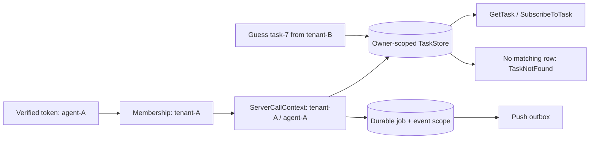

# Keep one verified tenant and owner across every task surface

> **Role:** production implementation. **Reader:** you can validate a bearer token and know the A2A Task lifecycle. The example uses wire protocol 1.0 and Python SDK 1.1.2; the SQL fixture below is a runnable isolation model, not an SDK server.

An invoice agent serves Acme (`tenant-A`) and Beta (`tenant-B`) from the same endpoint. Acme's `agent-A` has a valid token with `tasks:read` and guesses Beta's `task-7`. A scope answers *which kind of operation* the caller may request; it does not authorize this row. If a handler looks up `task-7` by ID before checking its owner, Acme can retrieve Beta's invoice or subscribe to its events.

## Derive the key at ingress

After validating token signature, issuer, audience, expiry, and scope as in [Authentication](01_authentication.md), look up the subject's memberships in server-owned storage. If `agent-A` belongs to `tenant-A`, an `X-Tenant: tenant-B` header is only a request to choose a tenant; reject it because the membership check fails. Never derive a tenant from the Message, Task ID, Agent Card URL, or unsigned header.

For SDK 1.1.2, `ServerCallContext` has `user`, `tenant`, and `state`; the shipped `resolve_user_scope(context)` returns **only** `context.user.user_name`. Therefore `tenant` alone cannot partition `DatabaseTaskStore`. Use a canonical composite user name, such as `tenant-A\x1fagent-A`, where both components come from the trusted membership lookup. The separator needs unambiguous encoding in real deployments; a length-prefixed or canonical UUID pair works well. Use the same key for every store, including push configurations. [SDK context](https://github.com/a2aproject/a2a-python/blob/v1.1.2/src/a2a/server/context.py), [owner resolver](https://github.com/a2aproject/a2a-python/blob/v1.1.2/src/a2a/server/owner_resolver.py).

This **excerpt** shows the application boundary after token validation. `AuthenticatedUser` is application code implementing the SDK `User` interface. The transport adapter must pass this exact context to the SDK handler; installing a FastAPI dependency without that handoff leaves the handler unauthenticated.

```python
from dataclasses import dataclass
from a2a.auth.user import User
from a2a.server.context import ServerCallContext

@dataclass(frozen=True)
class AuthenticatedUser(User):
    key: str

    @property
    def is_authenticated(self) -> bool:
        return True

    @property
    def user_name(self) -> str:
        return self.key


def call_context_for(principal, requested_tenant, membership_store):
    # principal is the already verified JWT/introspection result.
    if not membership_store.contains(principal.subject, requested_tenant):
        raise PermissionError("tenant membership required")
    owner_key = f"{requested_tenant}\x1f{principal.subject}"
    return ServerCallContext(
        user=AuthenticatedUser(owner_key), tenant=requested_tenant,
        state={"owner_id": principal.subject},
    )
```

The next diagram follows the same key. The guessed Task ID is data, while the owner predicate remains fixed by the verified context.



Acme's `GetTask(task-7)` must yield the same task-not-found result as an absent ID. `SubscribeToTask(task-7)` must fail **before** joining a live event queue. `GetTaskPushNotificationConfig(task-7)` and its set/delete counterparts must fail before disclosing or changing Beta's callback. A live-task shortcut that bypasses an owner-aware store can still leak despite a scoped SQL query. SDK 1.1.2 had this reported cancel/subscribe bypass; [1.1.4 fixed owner-scoped cancel/subscribe](https://github.com/a2aproject/a2a-python/releases/tag/v1.1.4). Treat 1.1.2 as a teaching baseline, not a production version, and test the actual active-task path after upgrading. See the [original report](https://github.com/a2aproject/a2a-python/issues/1159). Do not accept a passing store unit test as proof of the whole handler.

## Run a small isolation model

Save the following complete program as `isolation_model.py` and run `python3 isolation_model.py`. It uses only the Python standard library. It demonstrates the shared predicate and all three denial outcomes; it is not an A2A wire fixture.

```python
import sqlite3

con = sqlite3.connect(":memory:")
con.executescript("""
CREATE TABLE tasks(tenant TEXT, owner TEXT, id TEXT, state TEXT,
                   PRIMARY KEY(tenant, owner, id));
CREATE TABLE events(tenant TEXT, owner TEXT, task_id TEXT, seq INTEGER,
                    body TEXT, PRIMARY KEY(tenant, owner, task_id, seq));
CREATE TABLE push(tenant TEXT, owner TEXT, task_id TEXT, url TEXT,
                  PRIMARY KEY(tenant, owner, task_id));
INSERT INTO tasks VALUES ('tenant-B','agent-B','task-7','WORKING');
INSERT INTO events VALUES ('tenant-B','agent-B','task-7',1,'private update');
INSERT INTO push VALUES ('tenant-B','agent-B','task-7','https://beta.example/hook');
""")

def owned(table, columns, tenant, owner, task_id):
    key = "id" if table == "tasks" else "task_id"
    return con.execute(
        f"SELECT {columns} FROM {table} WHERE tenant=? AND owner=? AND {key}=?",
        (tenant, owner, task_id),
    ).fetchall()

for surface, table, columns in (
    ("GetTask", "tasks", "state"),
    ("SubscribeToTask", "events", "seq, body"),
    ("GetPushConfig", "push", "url"),
):
    assert owned(table, columns, "tenant-A", "agent-A", "task-7") == []
    assert owned(table, columns, "tenant-B", "agent-B", "task-7")
    print(f"{surface}: tenant-A denied; tenant-B allowed")
```

Expected output:

```text
GetTask: tenant-A denied; tenant-B allowed
SubscribeToTask: tenant-A denied; tenant-B allowed
GetPushConfig: tenant-A denied; tenant-B allowed
```

The queries include both tenant and owner even though the demo ID is globally unique. That matters when IDs collide, pagination is introduced, or a later migration changes ID generation. For actual `DatabaseTaskStore`, its owner resolver scopes task rows; separately verify the push store's owner behavior and scope any custom event broker or outbox. Apply the same predicate to list, cancel, continuation, update, delete, and push set/get/list/delete. Bind signed page tokens to tenant, owner, filters, and expiry.

## Preserve scope after the HTTP response

An accepted `SendMessage` writes `(tenant-A, agent-A, task-9)` and a durable job in one transaction. The worker claims that row and reads its persisted tenant/owner; a queue payload saying `tenant-B` cannot change it. Each checkpoint and event carries the same pair. A subscriber's verified context must match it before replay or live fan-out. Your push dispatcher must load the configuration through that pair and verify the event's task belongs to it before delivery. In SDK 1.1.2, `DatabasePushNotificationConfigStore.get_info_for_dispatch(task_id)` explicitly reads **across all owners** by Task ID. Do not use it as a tenant authorization boundary; use globally unique task IDs plus an application dispatcher that checks the persisted owner, or replace that dispatch path with one whose lookup includes the owner. [Source](https://github.com/a2aproject/a2a-python/blob/v1.1.2/src/a2a/server/tasks/database_push_notification_config_store.py). This avoids rebuilding authority from a stale, forgeable queue message.

When upgrading a 1.1.2 prototype for production, test the *assembled* HTTP/gRPC adapter, handler, store, live subscription path, worker, and push dispatcher on the newer release. With two clients, assert Acme gets task-not-found for Beta's known ID on each binding and cannot observe an event or callback. Repeat while Beta's task is actively running, because live paths can differ from persisted reads. Record denial counts without logging credentials or artifact bodies.

### Verify the real JSON-RPC handler handoff

The [local route fixture](../examples/production/auth_route_fixture.py) installs SDK 1.2.2's `create_jsonrpc_routes` with a `DefaultServerCallContextBuilder` subclass and real `DefaultRequestHandler`. Its two local bearer strings stand in for already verified principals. It holds Beta's task in `WORKING`, then Acme calls the actual route with Beta's known Task ID:

```bash
uv venv /tmp/a2a-route-venv --python 3.12
uv pip install --python /tmp/a2a-route-venv/bin/python 'a2a-sdk[http-server]==1.2.2'
/tmp/a2a-route-venv/bin/python examples/production/auth_route_fixture.py
```

The asserted result is `TASK_NOT_FOUND` for `GetTask`, `CancelTask`, `GetTaskPushNotificationConfig`, and active `SubscribeToTask`; an Acme `X-Tenant: tenant-B` hint receives HTTP 403; Beta sees `WORKING` then `COMPLETED`. The fixture verifies context propagation and SDK owner checks on this JSON-RPC path. It uses an in-memory store and does not exercise JWT verification, SQL isolation, gRPC/REST bindings, a real push callback, or cluster-mode event replay. Run those boundaries with your deployed stores and gateway before release.

## Retain the model

- Token validation establishes the subject and operation scopes; membership chooses the permitted tenant.
- A verified tenant/owner pair becomes one context key, then a predicate on every task, event, job, and push record.
- A guessed ID cannot remove that predicate. An inaccessible task looks absent on all read and stream surfaces.
- A queue or live registry is another access path and must repeat the check.

**Q:** Acme's token has `tasks:read`, but it requests Beta's `task-7`. Why is the scope insufficient?

<details><summary>Answer</summary>

The scope permits a read operation. It does not match the row's tenant and owner. The scoped query returns no row, so the handler reports task-not-found.

</details>

**Q:** The SQL fixture passes, but Acme receives one live event from Beta. What should you inspect first?

<details><summary>Answer</summary>

Inspect the handler's active-task subscription path and broker fan-out. A live registry may attach by Task ID without consulting the owner-aware store; a persisted-query test cannot catch that.

</details>

**Try it:** Add a `CancelTask` operation to the fixture. Start with `UPDATE tasks SET state='CANCELED' WHERE ...`. Which three predicates belong after `WHERE`? Check the affected row count, then try both callers.

<details><summary>Worked answer</summary>

Use `tenant=? AND owner=? AND id=?`. With `('tenant-A','agent-A','task-7')`, `rowcount` is zero and Beta's state stays `WORKING`. With Beta's verified pair, `rowcount` is one. A zero count maps to the same task-not-found result as an absent task.

</details>

---

**Next:** [Conformance & Interoperability](05_conformance_and_interoperability.md)
